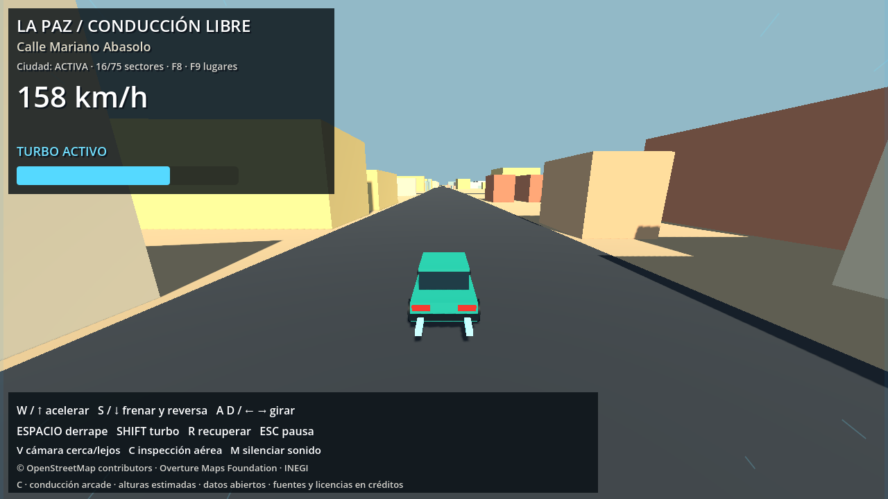
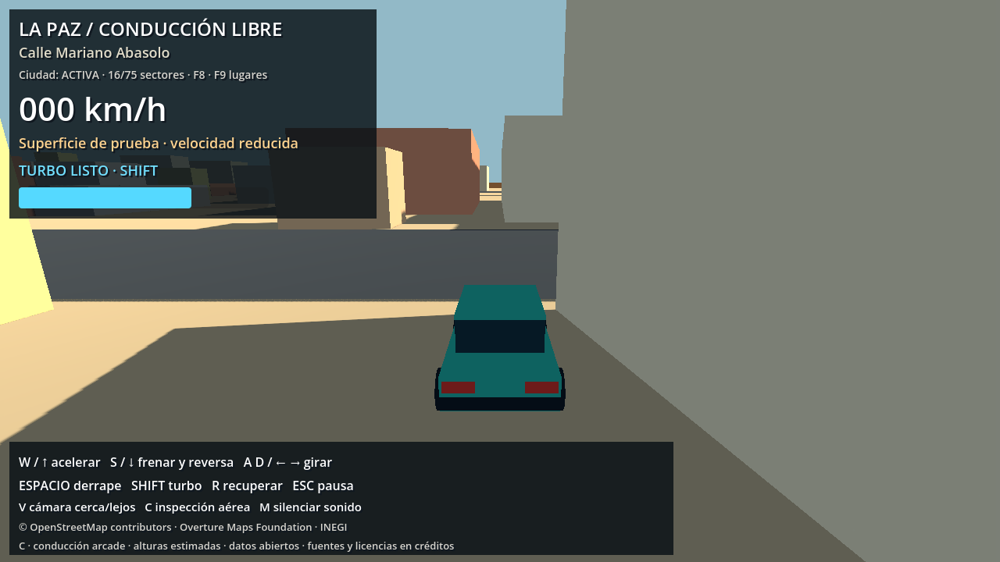

# Calles más anchas y corrección de bordes — 25 de octubre de 2026

## Cambios

Las calles jugables usan el mayor valor entre el ancho anterior multiplicado por 1,6 y 12 m. Ejemplos: residencial de 7 a 12 m; avenida de 12 a 19,2 m. Los ejes, cruces y rutas de OSM permanecen en sus coordenadas originales. Estos anchos son una adaptación arcade, no medidas reales.

`tools/build_arcade_layout.py` genera `data/processed/arcade_layout.json` desde los archivos procesados existentes, sin red y sin alterar el mapa ni los sectores urbanos de origen. Une el asfalto y triangula por sectores, conservando huecos/intersecciones. Ajusta 584 huellas urbanas y omite 3 volúmenes que ya no tienen suficiente área. Las fachadas y sus colisiones usan la misma geometría, con 0,8 m de separación respecto de la calzada ampliada. Cuando una huella se divide se conserva la parte mayor, sin conectar piezas a través de la calle. La Catedral conserva su modelo especial.

Los ajustes se aplican al cargar cada sector; las pruebas de fachadas consultan también las huellas adaptadas. La carga comprueba hashes del mapa, manifiesto urbano y configuración para impedir usar una adaptación desactualizada. El modo histórico `--legacy-city` conserva los anchos antiguos.

## Bugs corregidos

1. **Coche atascado al volver:** la plataforma física terminaba en Y=-0,08 mientras el asfalto estaba en Y=0. Al salir, el coche bajaba y podía encontrar el borde de los triángulos al intentar regresar. Ahora la plataforma física está a Y=0 en toda el área; las pruebas verifican salida y retorno con apoyo continuo.
2. **Vacío bajo el asfalto:** al cargar la geografía B.6 se ocultaba el fondo neutro. Las superficies cartografiadas solo cubren su región, dejando el margen del mapa sin fondo. La plataforma visual ahora permanece visible, 10 cm por debajo del asfalto y debajo de las superficies de tierra/agua, sin superposición visible con ellas. También cubre los huecos entre sectores. El terreno visual conserva el pequeño desnivel estético; la física es completamente plana.

## Verificaciones ejecutadas

- Generador: asfalto de 494.421,8 a 860.970,1 m²; error de área triangulada menor de 0,000001 m²; sin invasión del asfalto por las huellas ajustadas. Conserva la superficie anterior.
- `tests/godot_road_edges.gd`: seis salidas y retornos en seis tramos reales, con ciudad y colisiones activadas. Sin paredes invisibles, recuperaciones ni pérdida de apoyo; variación vertical menor de 5 mm. Las pruebas orientan el vehículo hacia el regreso una vez fuera y lo hacen cruzar el borde por sus propios medios, sin teletransportarlo al asfalto.
- `tests/godot_phase_b.gd -- --road-regression`: recorrido de unos 1,2 km, 14 cruces, sin salidas, choques ni recuperaciones; también pasan teclado, reversa, fachadas, cámara, límites y pausa.
- `tests/godot_phase_c.gd`: turbo, derrape, agarre, cámaras, sonido, HUD y pausa aprobados.
- Render real 1280×720: revisadas las vistas de turbo y del vehículo fuera del asfalto; suelo continuo visible.

Informes: `road_edges_validation.json`, `road_width_route_validation.json` y `phase_c_validation.json`.

## Reproducir y ajustar

Los parámetros están en `config/arcade_roads.json`. El juego ya incluye el resultado generado. Si cambias los parámetros o regeneras mapa/ciudad, ejecuta de nuevo el generador después de la generación urbana:

```powershell
.\.venv-urban\Scripts\python.exe tools/build_arcade_layout.py
$g = '..\..\Godot_v4.7.2-stable_win64_console.exe'
$env:APPDATA = Join-Path (Get-Location) '.godot/test_userdata'
& $g --headless --path . --fixed-fps 60 --script tests/godot_road_edges.gd
& $g --headless --path . --fixed-fps 60 --script tests/godot_phase_b.gd -- --road-regression
& $g --headless --path . --fixed-fps 60 --script tests/godot_phase_c.gd
& $g --path . --fixed-fps 60 --script tests/capture_phase_c.gd -- --road-fix
```

Los edificios siguen siendo obstáculos. El retorno al asfalto requiere un espacio libre real; no se desactivaron colisiones de fachadas para permitir atravesarlas.



