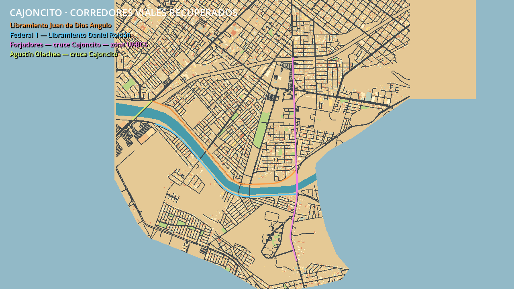

# Cajoncito — restitución de corredores principales

Se incorporan Libramiento Juan de Dios Angulo, los tramos de Federal 1/Transpeninsular en el bloque activo, Forjadores y el cruce de Agustín Olachea con el Cajoncito. No cambia la línea roja ni la envolvente de los bloques.

## Causa y corrección

El importador omitía `highway=trunk` y `trunk_link`; además, la política de escena plana excluía todas las vías `bridge=yes` o `layer=1`. Los XML OSM originales ya contenían esas carreteras. Se normalizaron de nuevo las 28 teselas verificadas y el snapshot original del núcleo mediante `fetch_expansion_osm.py --offline`, sin descargas y sin editar las respuestas originales. Los nuevos agregados se guardan con sufijo `c5_cajoncito`.

Se añaden las dos clases y sus anchos de respaldo. Cuatro tramos de Forjadores tienen admisión explícita y auditada como cruces planos provisionales: 127454232, 127454233, 443101245 y 443101250. Las etiquetas de origen bridge/layer permanecen intactas y la estilización se registra por tramo. Las restricciones de acceso, vías privadas y túneles continúan excluidos.

La Federal 1 comparte aquí tramos con Forjadores y el libramiento Daniel Roldán Zimbrón; no se dibuja una carretera paralela ficticia. Juan de Dios Angulo conserva su nombre propio. El cruce de Olachea con el cauce queda dentro de los bloques actuales; el paso elevado 54739509 que está al oeste es otro cruce y no se incorpora ampliando el mapa.

## Límite técnico explícito

Esta fase conserva el relieve y las carreteras a altura plana. No implementa todavía pasos elevados con circulación simultánea por debajo. La vía OSM sin nombre 660516292, que cruza bajo los terraplenes de Forjadores según las capas de origen, se aplaza de forma explícita para evitar una intersección física falsa en esa escena plana. Su geometría original permanece en la caché y la exclusión consta en el mapa procesado. No se alteran los nodos OSM para inventar un cruce.

## Construcción y conectividad

La red pasa de 12.731 a 13.092 segmentos y de 21.792 a 22.139 aristas dirigidas. Desde el núcleo se alcanzan 10.357 de 10.597 nodos, frente a 9.347 de 10.325 anteriormente. El área activa continúa en 41,98 km² y la línea roja se mantiene idéntica.

Se regeneran entorno, ciudad, adaptación de asfalto, fachadas y sectores con las mismas reglas del núcleo. Quedan 519 sectores urbanos, 537 sectores de asfalto arcade, 59.635 volúmenes antes del ajuste arcade y 59.580 habilitados después de omitir 55. Las alturas siguen estimadas. El ajuste de fachadas por sector evita edificios dentro del asfalto recuperado.

## Rutas de prueba

El perfil conserva las cadenas de nodos originales por vía. Las cuatro rutas críticas parten del núcleo y obligan a pasar por sus nodos dirigidos; no basta con llegar cerca ni se inventan conectores:

- Juan de Dios Angulo: 9,556 km incluyendo acceso desde Centro.
- Federal 1 / Daniel Roldán: 9,390 km incluyendo acceso.
- Forjadores / Cajoncito / zona UABCS: 11,618 km, incluyendo ambos sentidos y los cuatro cruces revisados.
- Olachea / Cajoncito: 6,008 km incluyendo acceso.

Son candidatos para futuras carreras ficticias y pruebas del coche; no añaden una carrera al menú.

```powershell
.\.venv-urban\Scripts\python.exe tools/fetch_expansion_osm.py --offline
.\.venv-urban\Scripts\python.exe tools/expand_map.py
.\.venv-urban\Scripts\python.exe -B -m unittest discover -s tests -v
$g = '..\..\Godot_v4.7.2-stable_win64_console.exe'
& $g --headless --path . --fixed-fps 60 --script tests/godot_phase_c5.gd -- --critical-corridors
& $g --path . --fixed-fps 60 --script tests/godot_phase_c5.gd -- --critical-corridors
& $g --path . --fixed-fps 60 --script tests/capture_cajoncito.gd
```




## Resultados de validación

42 pruebas Python aprobadas, incluyendo importación por clase, política de puentes, integridad de fuentes, nodos dirigidos obligatorios y comprobación de que todos los triángulos y huellas siguen respetando el recorte rojo. La regeneración offline completa pasó las validaciones de mapa, ciudad y geografía.

El coche de producción completó los cuatro recorridos críticos sin render: 36,56 km y 414 intersecciones, con cero salidas del asfalto, pérdidas de apoyo, choques o recuperaciones durante la conducción. Forjadores se repitió con render: 11,615 km, 137 cruces, p95 de cuadro 1,658 ms y pico de memoria estática 193,1 MiB; el máximo aislado fue 61,944 ms. Se verificaron fachadas/cámara en siete referencias y reinicio desde el sur.

El benchmark estático del mismo punto inicial, cámara 1280×720 y RTX 4060 Ti, registró 0,800 ms medios por cuadro, 181,8 MiB de memoria estática e inicio en 1,26 s. Pasan los presupuestos existentes de cuadro y memoria. Las cifras son locales a este equipo y la memoria estática no es RAM total ni VRAM.

Informes: `cajoncito_validation.json`, `cajoncito_driving.json`, `cajoncito_driving_render.json` y `cajoncito_benchmark.json`. Capturas de los cuatro corredores y vista general revisadas visualmente. La vista general carga todos los sectores únicamente para inspección.

También pasan nuevamente la prueba física del recorte rojo y seis salidas/reingresos al asfalto, dos de ellas sobre el tramo recuperado de Juan de Dios Angulo 1408135348.
