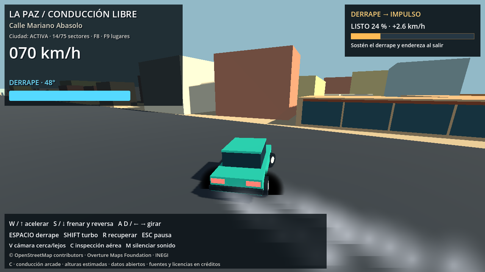
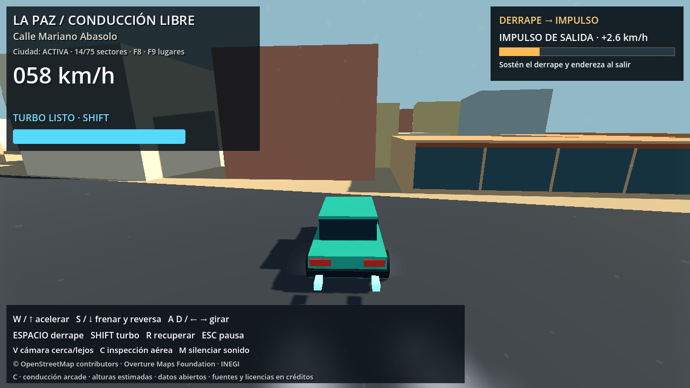
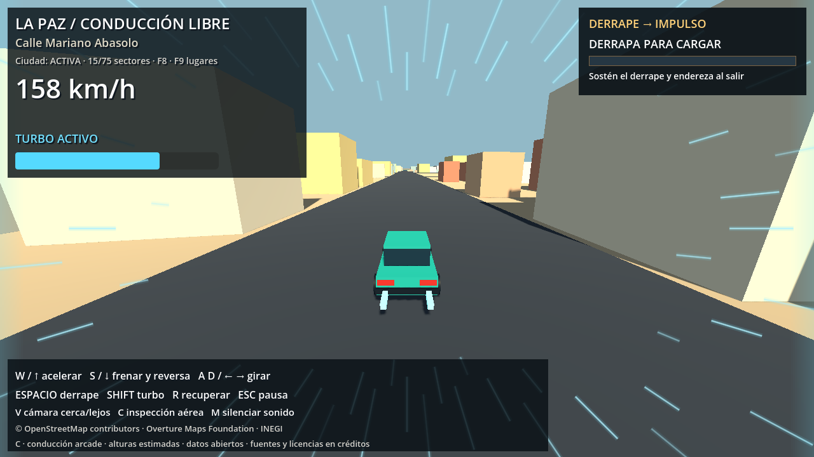

# Derrape con recompensa y efectos de velocidad

Implementado el 25 de octubre de 2026, sobre la conducción de fase C y las calles ampliadas.

## Cómo jugar

Acelera, gira y mantén brevemente **Espacio** para deslizar. El medidor naranja carga con el ángulo, la velocidad y la duración del derrape. Al indicar **LISTO**, suelta Espacio, corrige la dirección y conserva el acelerador. Enderezar el coche entrega automáticamente un impulso breve; un derrape mejor entrega más impulso. El HUD muestra tanto la carga como el aumento de velocidad previsto. No hay otra tecla para activarlo.

La carga exige deslizamiento de 12° a 55°, avance superior a 9 m/s y dirección aplicada. El ángulo óptimo y la velocidad alta cargan más rápido. Frenar en recta no carga. Se requieren al menos 0,4 s de derrape válido y 22 % de carga. Fuera del intervalo de control la carga decae; perder velocidad, chocar, salir del asfalto, quedar en el aire, frenar con S, recuperar o pasar a inspección cancela la recompensa.

Al soltar Espacio, el coche debe mantener menos de 8° de deslizamiento durante 0,1 s, en un plazo de 1,5 s. Con acelerador recibe una sola recompensa. La carga se consume y no puede volver a premiar la misma salida.

## Impulso y efectos

- Duración: **0,9 s**. Aceleración adicional proporcional a la carga, con incremento nominal máximo de **3 m/s (10,8 km/h)** para carga completa. El aporte se reparte durante el impulso; no es un salto instantáneo de esa magnitud.
- El límite normal puede crecer en esa misma cantidad durante el impulso. Al terminar vuelve al habitual. Las colisiones y el agarre siguen determinando la velocidad real.
- La reserva de Shift no se gasta. El turbo sustituye al impulso de derrape; no se suman. Un nuevo freno de mano o soltar el acelerador cancela el impulso activo.
- Dos emisores CPU, uno en cada rueda trasera, generan humo suave con textura radial procedural. Las partículas quedan en el mundo y se desvanecen, sin colisiones ni sombras. Solo emiten con deslizamiento real, apoyo y asfalto. Recuperar limpia la estela. Máximo de 96 partículas simultáneas.
- La recompensa añade una pequeña respuesta de cámara, sonido y escape; las líneas periféricas se tiñen de dorado.
- Turbo: **64 líneas** animadas, largas, con núcleo claro y halo cian. Ahora atraviesan la zona visible de los bordes en lugar de aparecer principalmente fuera del encuadre. El centro permanece despejado.
- La pausa congela movimiento, carga, duración del impulso y partículas.

Parámetros de equilibrio en `config/driving_config.json`, claves `drift_charge_time_s`, `drift_min_charge`, `drift_min_duration_s`, `drift_bonus_mps`, `drift_bonus_duration_s` y `drift_exit_timeout_s`.

## Verificación ejecutada

Godot 4.7.2, física a 60 Hz.

`tests/godot_drift_rewards.gd` utiliza una plataforma sintética explícita y el controlador de producción. Verifica carga proporcional a la duración, salida limpia, recompensa única, aumento real frente a la misma salida sin premio, teclado físico W/D/Espacio, pausa, humo, cancelación por choque real, salida del asfalto, trompo, inspección y recuperación. También verifica que Shift sustituya el impulso sin superar su límite.

Mediciones de esa prueba: derrape controlado de 1,5 s, carga **38,7 %**; frente a **9,1 %** en el intento más corto. En la misma salida física, tras medio segundo el coche con premio alcanzó **27,56 m/s**, frente a **26,91 m/s** sin premio: **+0,65 m/s (+2,3 km/h)**. La prueba de teclado digital también entrega recompensa.

Pasaron además la suite de fase C, el recorrido de unos 1,2 km con 14 cruces y las seis pruebas de salida/reingreso al asfalto. Informes: `drift_rewards_validation.json`, `phase_c_validation.json`, `road_width_route_validation.json` y `road_edges_validation.json`.

`tests/capture_drift_effects.gd` reproduce derrape, salida con impulso y turbo en la ciudad real, render OpenGL 1280×720. Capturas revisadas visualmente. La primera salida renderizada produjo 23,7 % de carga y su impulso correspondiente. Queda la valoración subjetiva del equilibrio al jugar.

```powershell
$g = '..\..\Godot_v4.7.2-stable_win64_console.exe'
$env:APPDATA = Join-Path (Get-Location) '.godot/test_userdata'
& $g --headless --path . --fixed-fps 60 --script tests/godot_drift_rewards.gd
& $g --headless --path . --fixed-fps 60 --script tests/godot_phase_c.gd
& $g --headless --path . --fixed-fps 60 --script tests/godot_phase_b.gd -- --road-regression
& $g --headless --path . --fixed-fps 60 --script tests/godot_road_edges.gd
& $g --path . --fixed-fps 60 --script tests/capture_drift_effects.gd
```




