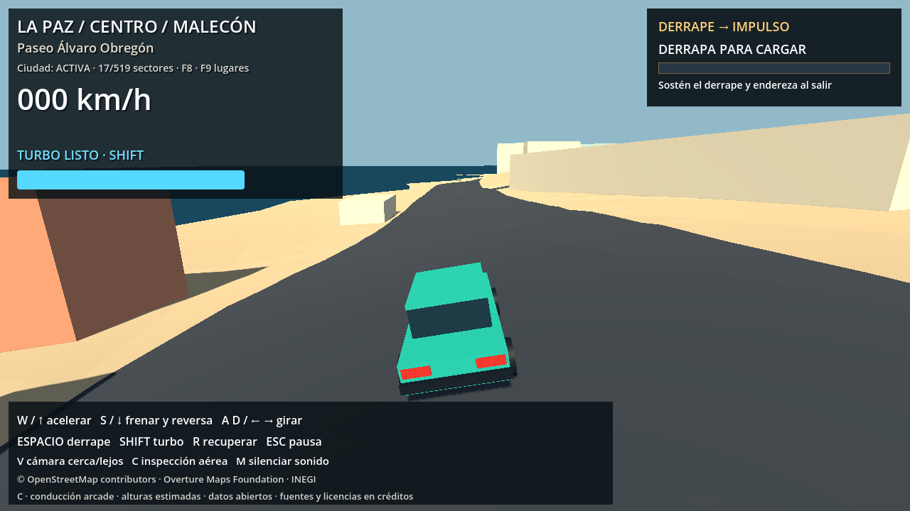

# B.7-R — Relieve geográfico real

La física de conducción se amplió después por solicitud del usuario: [gravedad en pendientes, retroceso y vuelos cortos](SLOPE_PHYSICS.md). Los parámetros y cifras de conducción de la implementación inicial que aparecen abajo se conservan como historial; consultar esa actualización para la respuesta física actual.

Estado: relieve completo integrado en el arranque principal tras la aprobación visual del piloto y la autorización del usuario. Se conservan limitaciones de fuente vertical, pasos a distinto nivel y cimentaciones grandes; no se declara cerrada toda la lista de aceptación. Tras validar el piloto, el mapa completo y añadir las físicas, el usuario autorizó publicar la versión actual junto con el interruptor de pruebas **T** (velocidad y aceleración ×2). La restricción anterior de no publicar queda sustituida por esta autorización. Pruebas de esta entrega: `docs/debug_speed_release.json`.

## Ejecutar

- Abrir `scenes/ReliefPilot.tscn` en Godot y pulsar F6: área norte de 768×768 m, nueve sectores, 346 edificios y carretera con unos 27 m de variación vertical en el recorrido de prueba.
- **F5** ejecuta `scenes/Main.tscn` con relieve completo: centro, norte y sur, manteniendo el recorte sur y el spawn original de la ciudad. `scenes/ReliefWorld.tscn` ofrece el mismo perfil para F6.
- `scenes/FlatWorld.tscn` conserva el mundo plano para comparar con F6. F8, F9, cámara, controles y recuperación siguen disponibles.
- Alternativa por terminal: `Godot --path .` inicia el mundo completo; `-- --flat-world` selecciona el plano y `-- --relief-pilot` selecciona el piloto. La opción explícita `--flat-world` tiene prioridad si se combinan flags.

No combinar relieve con `--legacy-city`: la integración usa las huellas y fachadas de la ciudad actual.

## Fuente real y referencia vertical

Se obtuvo un recorte del **INEGI CEM 4.0** desde el WCS oficial. Las respuestas de `api/versiones` y `api/resoluciones?version=2` identifican inequívocamente versión 4.0 y capa `cem4_workespace:cem15m_3857`. No se descargó el ZIP nacional de 8,9 GB ni se usaron servicios de elevación punto a punto.

Snapshot: `data/raw/elevation/cem4_la_paz.tif`, 786.852 bytes, SHA-256 `cd41d14bbf80ef21664c568200c1c8c483c939bfa7a5373a49bd6947e3240020`. Se conservan consulta exacta, fecha, respuestas de selección de versión, DescribeCoverage y verificación local junto al TIFF. Es un recorte de la envolvente actual más halo de unos 500 m, no nuevo territorio jugable.

La salida WCS tiene 511×756 muestras int16, CRS **EPSG:4326**, interpretación PixelIsArea y NoData=32767. La transformación real está en `source_verification.json`: no se presupone que resx solicitado sea exactamente el resx entregado. El WCS declara vecino más cercano por defecto y usa una capa nativa EPSG:3857; esta exportación no se presenta como raster nacional original sin reprocesar. Rango de muestras válidas del recorte: −6 a 337 m; 27.781 muestras NoData de 386.316, principalmente mar.

El proveedor describe alturas en metros sobre nivel medio del mar. **Y del juego = altura de esa referencia, origen vertical 0, mar Y=0, sin exageración.** No se confirmó el geoide específico ni una precisión vertical local del CEM 4.0. No se atribuye al producto la precisión de CEM 3.0 ni se confunde resolución horizontal de 15 m con precisión vertical. No se mezclan datums verticales de fuentes distintas. Copernicus y LiDAR fueron alternativas examinadas, no fuentes usadas; no se afirma cobertura LiDAR comprobada.

Fuente: [ficha oficial CEM 4.0](https://www.inegi.org.mx/app/biblioteca/ficha.html?upc=794551151600), [visor INEGI](https://www.inegi.org.mx/app/geo2/elevacionesmex/), [términos de libre uso](https://www.inegi.org.mx/inegi/terminos.html). Las transformaciones para el juego son propias y están declaradas también en `CREDITS_AND_LICENSES.md`.

## Arquitectura implementada

`fetch_elevation.py` descarga y verifica un snapshot acotado. `relief_core.py` interpreta centros de píxel, invierte exactamente la conversión existente de radio 6371000 m/origen 24.159,-110.3195 y prepara una grilla de 8 m. Se mantiene 1 unidad=1 metro; no existe una segunda proyección del mundo.

Se aplica suavizado gaussiano de 20 m, declarado como adaptación del juego. Una superficie canónica de dos triángulos por celda proporciona las cotas compartidas. `ElevationService.gd` usa interpolación lineal sobre **esos mismos triángulos**, con respuesta válida/fuera de cobertura, altura, estimación y ajuste. No usa una bilineal que difiera de la colisión. El TIFF original conserva las elevaciones previas a ajustes y puede consultarse offline con `Elevation.sample(..., smoothed=False)`.

Las muestras runtime son float32 binario y la calidad un byte por nodo, con hashes y cabecera JSON pequeña. Calidad 0: DEM interpolado/ajustado; 1: fondo marino estimado; 2: fuera del soporte jugable; 3: interpolación costera estimada en huecos a no más de 32 m del mar conocido. Un hueco terrestre interior aborta la preparación. La superficie completa se declara ajustada: calidad 0 no significa medición directa en cada nodo nuevo.

La unión arcade existente se intersecta con cada triángulo de la grilla; el resto terrestre usa la misma partición. Esto añade muestras longitudinales, mantiene cotas comunes en cruces y produce superficies de render/colisión idénticas. No se elevan independientemente los vértices de los triángulos largos anteriores. El grafo OSM y sus coordenadas XZ no cambian. No se crean conexiones en cruces sin nodo.

Donde una pendiente vial excede el umbral se proyectan localmente los gradientes de los triángulos, conservando las anclas de la costa. Las pendientes que ya cumplen el límite no se aplanan globalmente. En el mundo preparado se ajustaron 298 nodos más de 10 cm; cambio local máximo de esa corrección: 4,915 m. La pendiente máxima física cuantizada es 38,4%, por debajo del límite de revisión configurado de 42%. Son cotas de juego derivadas de DEM, no perfiles de calzada levantados en campo.

Los cortes comparten líneas de grilla y planos antes de dividir por sectores, evitando T-junctions relevantes. Se eliminan y contabilizan triángulos de menos de 0,5 mm de altura horizontal cuya normal se vuelve inestable al cuantizar a float32. Área omitida total del mundo: 0,440 m² sobre decenas de km²; el piloto valida cobertura y secuencias comunes de borde. No se afirma geometría matemáticamente sin ninguna omisión submilimétrica.

`RoadChunkManager.gd` se reutiliza para asfalto, terreno y límites: 256 m, carga 1100 m, descarga 1400 m, soporte inmediato 300 m y retención de los vecindarios de spawn/recuperación. La ciudad mantiene sus radios 650/850/240 m. Los límites se agrupan en 142 sectores de colisión y se cargan por proximidad; no hay miles de cajas globales. La plataforma plana no existe en las escenas de relieve.

El bake opcional `bake_relief_resources.gd` empaqueta mallas y formas físicas en escenas binarias comprimidas del motor. El juego verifica sus hashes e instancia recursos, evitando calcular normales y construir colisiones complejas mientras se conduce. Hay 1294 recursos de asfalto/terreno/límites, unos 52,18 MB adicionales. Si cambia la versión de Godot se descarta ese caché y se usan las fuentes triangulares verificadas; conviene regenerarlo. La geometría base es reproducible con las versiones fijadas; no se exige identidad byte a byte de identificadores internos de recursos nativos entre versiones del motor.

## Edificios, costa y automóvil

Las huellas se procesan después de overrides y recortes arcade, conservando patios, techos, alturas y modelos compatibles. Cada edificio tiene cota base nivelada y fondo de cimentación hasta el terreno. Se trasladan techos, fachadas, ventanas, modelos y colisiones juntos. El mundo contiene 59.580 volúmenes efectivos: las 55 omisiones arcade ya existentes siguen omitidas, no son pérdidas causadas por relieve.

Hay **20 cimentaciones con diferencia de suelo superior a 6 m**, máximo 13,365 m, pendientes de revisión visual individual. Sus IDs/huellas se listan en `data/processed/relief/world/foundation_review.json`; el piloto tiene un caso. No se afirma que estos zócalos grandes reproduzcan cimentaciones reales. No se deforman cubiertas ni se alteran fuentes para ocultarlo.

Se conserva la máscara marítima OSM. El litoral real se distingue de bordes artificiales de recorte: anclas a cero en banda de 16 m, transición suave al DEM hasta 64 m y correcciones explícitas en el manifiesto. Esta adaptación resuelve la diferencia de escala DEM/litoral; su cambio máximo local es 16,778 m, no precisión geodésica. El validador muestrea 1326 puntos del litoral, todos a Y=0. No se genera terreno visible sobre el mar ni se infiere batimetría real. Al salir al mar y perder soporte se conserva la recuperación a la última vía segura.

El coche sigue siendo CharacterBody3D con caja vertical y los mismos parámetros de conducción. Se cambiaron raycasts relativos a posición, spawn/recuperación según altura y colocación según apoyo de toda la caja. La carrocería visual se orienta con cuatro contactos; ruedas y humo siguen esos contactos. No se afirma suspensión física ni dinámica de un simulador. La gravedad/grip/aceleración de configuración no se retocaron para disimular geometría.

Los cuatro puentes de Forjadores conservan la política anterior y el cruce inferior 660516292 sigue excluido. El DEM no determina gálibo ni cota de tablero: esta entrega no añade tránsito simultáneo en niveles superpuestos. La unión 2D del proyecto permanece adecuada a la red actualmente admitida, no a puentes futuros.

## Reproducción y pruebas

Dependencias offline fijadas en `tools/requirements-relief.txt`; no se agregaron complementos ni dependencias Python al ejecutable Godot.

```powershell
.\.venv-urban\Scripts\python.exe -m pip install -r tools/requirements-relief.txt
.\.venv-urban\Scripts\python.exe -B tools/fetch_elevation.py
.\.venv-urban\Scripts\python.exe -B tools/build_relief.py --mode pilot
.\.venv-urban\Scripts\python.exe -B tools/build_relief.py --mode world
$g = '..\..\Godot_v4.7.2-stable_win64_console.exe'
& $g --headless --path . --script tools/bake_relief_resources.gd -- --mode=pilot
& $g --headless --path . --script tools/bake_relief_resources.gd -- --mode=world
.\.venv-urban\Scripts\python.exe -B tools/validate_relief.py --mode pilot
.\.venv-urban\Scripts\python.exe -B tools/validate_relief.py --mode world
.\.venv-urban\Scripts\python.exe -B -m unittest discover -s tests -v
& $g --headless --path . --fixed-fps 60 --script tests/godot_relief.gd -- --relief-pilot
& $g --headless --path . --fixed-fps 60 --script tests/godot_relief_world.gd
& $g --headless --path . --fixed-fps 60 --script tests/godot_phase_c5.gd -- --b7r-regression
```

Si el TIFF ya existe, fetch solo verifica su hash y no requiere Internet. Los bakes escriben exclusivamente datos derivados nuevos. Ante fallo de preparación no ejecutar el perfil incompleto: sus hashes lo rechazan; `Main.tscn` y todas las fuentes anteriores siguen disponibles.

La validación urbana histórica protegía el hash del controlador. La migración autorizada de B.7-R conserva el controlador original exacto en `docs/b7r_baseline/ArcadeCar.gd`, exige el nuevo hash exacto en `config/relief_migrations.json` y enlaza un informe de regresión plana aprobado por hash. No se modificaron los hashes del manifiesto urbano original ni se desactivó su validación. Una edición posterior del controlador debe actualizar esta migración con nueva evidencia.

Resultados publicados:

- 47 pruebas Python aprobadas; cinco específicas de relieve cubren muestras reales, interpolación, cobertura/juntas, malla compartida, techos y patios.
- Piloto: unos 494 m conducidos en ambos sentidos, variación vertical de unos 27 m, dos sectores en cada recorrido; cero salidas, pérdida de apoyo, choques o recuperaciones. Aceleración y frenado en ambas pendientes aprobados; frenado de unos 19 m/s en 45 cuadros. Turbo alcanza 44,03 m/s con apoyo; F8, recuperación y límite físico aprobados.
- Mundo con relieve: cuatro recorridos de unos 23,7 km y siete referencias aprobados. Cero salidas del asfalto, pérdidas de apoyo, contactos de pared o recuperaciones durante recorridos. Streaming carga/descarga y recuperación distante aprobados. Pico observado: 106 sectores de asfalto y 106 de terreno; carga máxima registrada de cada uno 8 ms en esa ejecución. La carga urbana máxima observada fue 39 ms, por lo que no se garantiza ausencia absoluta de tirones.
- Validación de 1.776.750 triángulos y 1294 cachés nativos: hashes, finitud, recorte, cotas y gradientes físicos aprobados. Error máximo de malla frente a consulta de altura 0,016 mm; **es coherencia numérica interna, no precisión del DEM**.
- La regresión plana recorre los mismos cuatro corredores y prueba fachadas/cámara/recuperación sin fallos.

Informes: `phase_b7r_python.log`, `phase_b7r_pilot_physics.json`, `phase_b7r_world_physics.json`, `phase_b7r_flat_regression.json`, `phase_b7r_pilot_geometry.json`, `phase_b7r_world_geometry.json`. Los logs de Godot tienen aviso de caché de shaders no escribible en este entorno restringido; no se ignoran errores de geometría o scripts como si fueran esos avisos.

## Rendimiento y límites de aceptación

Comparación final de render en `phase_b7r_benchmark_world_flat.json` y `phase_b7r_benchmark_world_relief.json`: mismo punto norte, orientación de cámara, renderer Compatibility/RTX 4060 Ti, 1280×720, VSync desactivado, 2 s de calentamiento y 5 s de muestra. Se ejecutaron secuencialmente sin bake concurrente. Las medidas del piloto anteriores a caché/ajuste costero son historial de desarrollo y no la comparación final.

La comparación mide un escenario estático; no representa FPS garantizados en todos los sectores ni VRAM/RAM total. El monitor de física mide el paso completo y no aísla coste de colisiones. No se declara una mejora general por una sola muestra. Las cifras finales y razones quedan también en `phase_b7r_summary.json`.

Se repitieron tres pares de muestras secuenciales para investigar un cuadro largo:

| Métrica, mediana de las tres ejecuciones | Plano | Relieve |
|---|---:|---:|
| Tiempo medio de cuadro | 0,780 ms | 0,790 ms |
| p95 por ejecución | 1,010 ms | 1,060 ms |
| Memoria estática | 182,35 MiB | 198,02 MiB |
| Inicio de escena | 1236,64 ms | 1518,58 ms |

El promedio crece aproximadamente 1,3% y la memoria estática unos 15,67 MiB en este escenario. El primer ensayo de relieve registró un máximo de **174,465 ms**; los dos siguientes dieron máximos 5,351 y 5,382 ms, sin cuadros superiores a 16,67 ms. No se determinó el origen del primer pico y no se eliminó de los informes. El plano también tuvo máximos de unos 36–37 ms. No se garantiza ausencia de tirones ni se presenta el promedio como sustituto de esa investigación. Archivos `_2` y `_3` conservan las repeticiones y diagnósticos de cuadros largos.

La regeneración repetida del piloto comparó 40 archivos de geometría/muestras/ciudad sin cambios de hash: `phase_b7r_determinism.json`. Los recursos nativos pueden variar en IDs internos aunque su geometría coincida.

Aceptación verificada: fuente real/versionada y offline; terreno y vías con cotas compartidas; cruces de la red actual transitables; colisiones comunes; costa a referencia cero; streaming; recorridos de conducción; controles y depuración; regresión plana. Aceptación pendiente: precisión/geoide vertical específico de la fuente, revisión individual de las 20 cimentaciones grandes, inspección manual exhaustiva y nuevos niveles de puentes. Estas limitaciones permanecen documentadas aunque el usuario haya autorizado usar el relieve completo por defecto.

## Activación en el mapa principal

`Main.tscn` configura `relief_profile="world"`. El modo completo conserva el spawn de `la_paz_environment.json` y calcula su altura y apoyo con el servicio de elevación; el spawn norte preparado se reserva al piloto y a los benchmarks comparables. La precarga de terreno y límites usa el mismo spawn efectivo que las carreteras.

Las pruebas históricas que presuponen Y=0 cargan explícitamente `FlatWorld.tscn`; no cambian sus comprobaciones físicas. La prueba de integración `godot_relief_world.gd` carga **Main directamente y sin flags**, comprueba el spawn original, apoyo, recuperación, F8 y ausencia de plataforma plana, y recorre los cuatro corredores y siete referencias. Sus resultados se guardan en `phase_b7r_default_integration.json`. La nueva regresión plana se guarda en `phase_b7r_default_flat_regression.json`, conservando el informe histórico cuyo hash está ligado a la migración del controlador.

Resultado de activación: ambas pruebas aprobadas. El perfil de producción recorrió 23.690,8 m en cuatro rutas, con cero salidas, pérdidas de apoyo, contactos de pared o recuperaciones durante los recorridos; las siete referencias y el retorno al spawn original aprobaron. La geometría completa y las cinco pruebas Python específicas volvieron a aprobar. El arranque normal renderizado y el flag `--flat-world` se comprobaron por separado. Las medidas headless de esta regresión no son un nuevo benchmark gráfico. No se alteraron datos geográficos originales ni se crearon commits.



Optimización futura: LOD lejano o grilla más gruesa fuera de vías; carga en segundo plano de recursos nativos; presupuestar la precarga urbana durante teletransportes; perfilar VRAM/RAM del proceso y recorridos renderizados en más equipos. No ampliar cobertura LiDAR ni resolver tableros con alturas inventadas.
