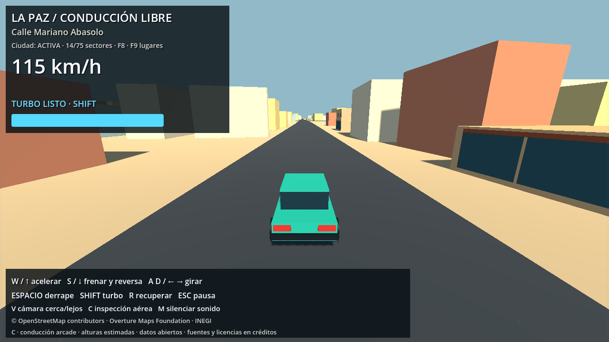
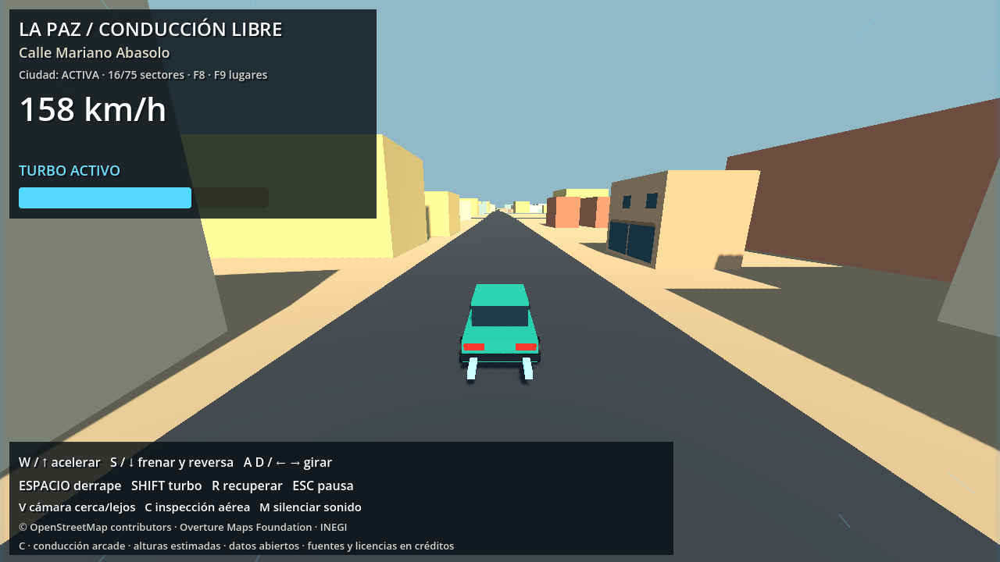

# Fase C — mecánicas principales

Entrega del 25 de octubre de 2026. Continúa el modo libre sobre la ciudad B.6.

## Conducción

- Aceleración 13 m/s², frenada 26 m/s², reversa limitada a 7 m/s y marcha normal a 32 m/s. Dirección progresiva sin rotación en parado y menor giro a alta velocidad.
- Espacio reduce el agarre a partir de 9 m/s. El agarre vuelve gradualmente al soltarlo. El HUD indica ángulo de deslizamiento; la carrocería se inclina y los neumáticos suenan según el deslizamiento.
- Shift mantiene turbo: aceleración 19 m/s² y límite 44 m/s, reserva de 3,5 s. Recarga en 8 s después de 1,2 s sin turbo. Umbral de activación: 18 %. Al agotarse hay que soltar Shift para volver a activarlo.
- Solo puede activarse con acelerador, sobre asfalto, con apoyo y avanzando a más de 2 m/s. Freno de mano, reversa e inspección lo desactivan. La recuperación reinicia movimiento, derrape y cámara; conserva reserva.
- V alterna distancias de persecución. La velocidad abre el campo de visión de 70° a 78°; el turbo alcanza 88° y aleja suavemente la cámara. SpringArm conserva la protección ante fachadas. C sigue siendo inspección aérea.
- Turbo: escapes cian animados, líneas periféricas y barra de reserva. No se usa desenfoque de movimiento ni sacudida aleatoria de cámara.
- Motor, derrape y turbo usan bucles originales sintetizados en memoria al iniciar, con volumen y tono dinámicos. M silencia. Los procesos respetan pausa; las ejecuciones headless omiten la síntesis.

## Validación ejecutada

Godot 4.7.2.stable.official.ed1daf0bf, paso fijo 60 Hz.

- `tests/godot_phase_c.gd`: prueba aislada sobre una plataforma sintética explícitamente destinada a pruebas; también instancia la escena de producción y comprueba HUD, pausa e inspección. Informe: `phase_c_validation.json`.
- `tests/godot_phase_b.gd`: regresión sobre las vías reales. Aproximadamente 1,2 km y 14 cruces, sin pérdida de apoyo, salidas del asfalto, contactos con paredes ni recuperaciones en el recorrido. Incluye teclado físico, reversa, fachadas, SpringArm, límites y menú. Informe: `phase_c_route_validation.json`.
- `tests/capture_phase_c.gd`: render real OpenGL a 1280×720 sobre una recta auténtica, con sonido inicializado y reproduciéndose. Capturas de crucero y turbo revisadas visualmente. Turbo medido: 44,005 m/s y FOV 87,72°; pequeñas diferencias del límite nominal provienen del paso físico.

Se ajustó la frenada tras detectar en la regresión que la aceleración mayor exigía más distancia para detenerse. Ambas suites pasan con los valores finales.

```powershell
$g = '..\..\Godot_v4.7.2-stable_win64_console.exe'
# Mantiene los datos temporales de pruebas dentro del proyecto.
$env:APPDATA = Join-Path (Get-Location) '.godot/test_userdata'
& $g --headless --path . --fixed-fps 60 --script tests/godot_phase_c.gd
& $g --headless --path . --fixed-fps 60 --script tests/godot_phase_b.gd -- --phase-c-regression
& $g --path . --fixed-fps 60 --script tests/capture_phase_c.gd
& $g --path .
```

## Prueba de sensación pendiente

Las pruebas verifican comportamiento físico y estados; no demuestran que conducir resulte emocionante. Jugar durante unos minutos: arrancar, enlazar curvas con toques breves de Espacio, soltar y corregir, activar Shift en rectas y alternar V. Evaluar previsibilidad, recuperación del derrape y claridad del turbo. El audio es provisional y se verificó su reproducción técnica; falta valoración auditiva humana. No se incorporaron rivales ni carreras en esta fase.



