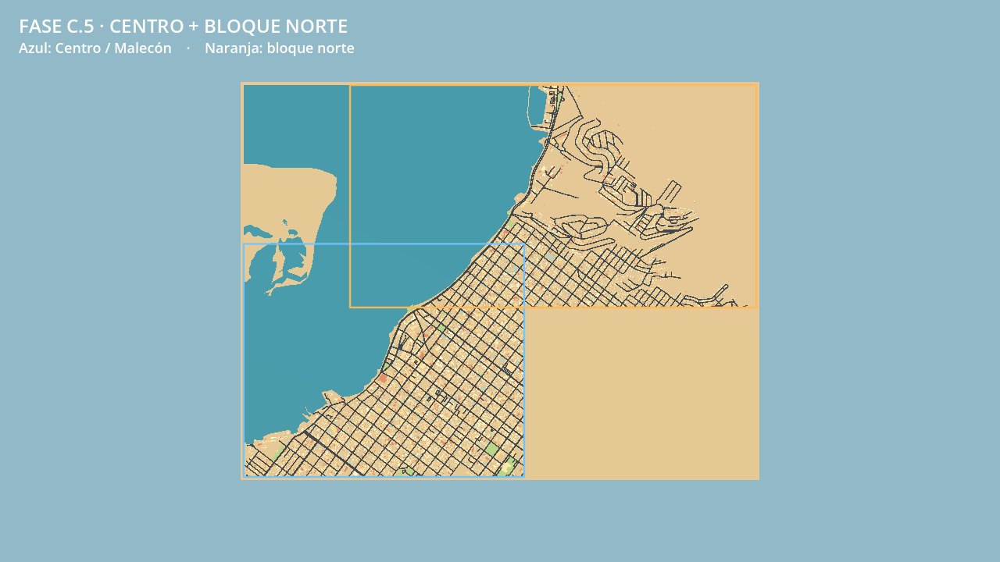
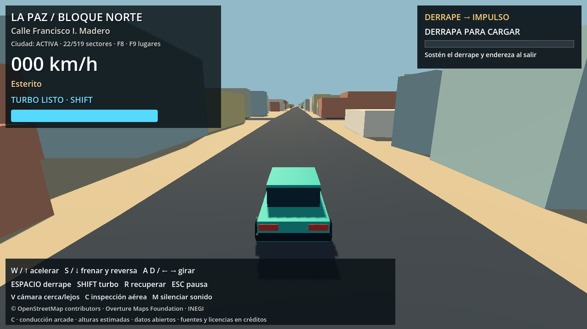
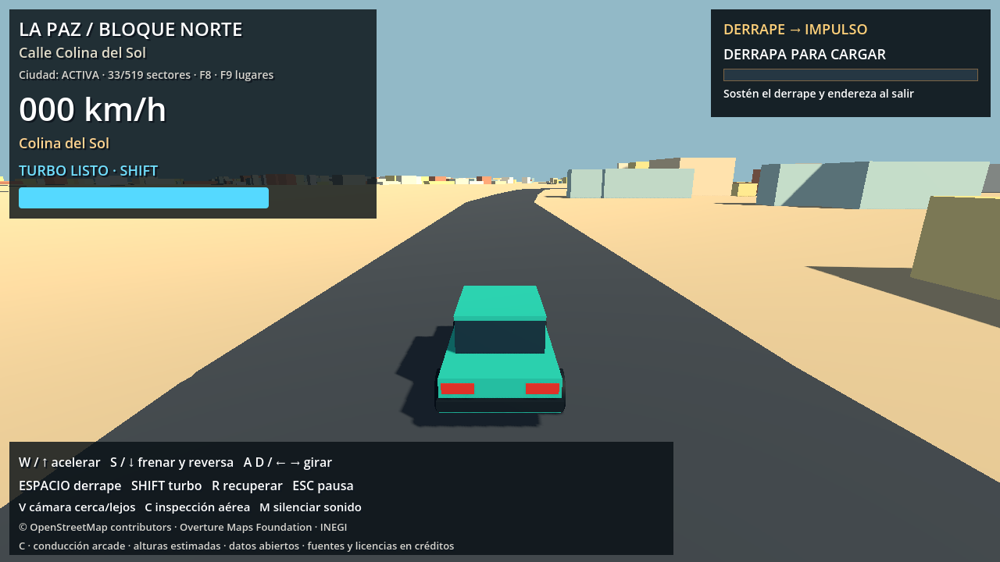
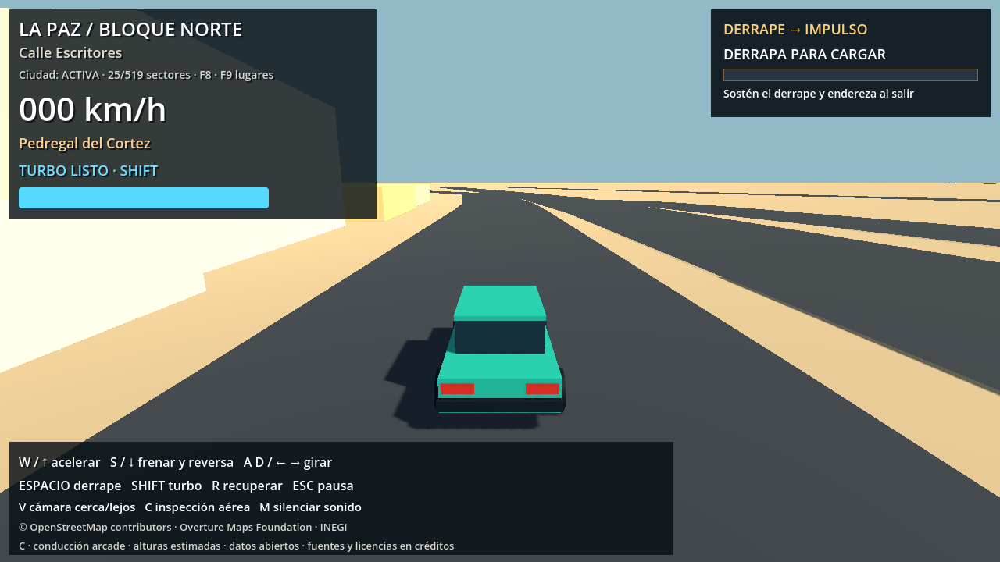
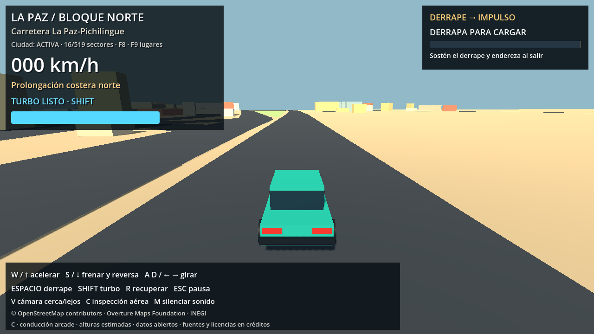

# Fase C.5 — primer bloque norte de La Paz

Entrega del 25 de octubre de 2026. Se conserva Centro/Malecón y se incorpora el bloque norte: Esterito, Colina del Sol, Pedregal del Cortez y prolongación de la Carretera La Paz–Pichilingue. La imagen roja del usuario es referencia para el perímetro final; el sur y los demás bloques de esa imagen quedan para etapas posteriores.

## Alcance medido

| Dato | Núcleo anterior | Núcleo + norte |
|---|---:|---:|
| Cobertura de los bloques, incluida zona marítima | 7,20 km² | 15,93 km² |
| Tramos viales OSM | 1.162 | 2.836 |
| Sectores de calles de 256 m | 74 | 138 |
| Volúmenes urbanos antes de adaptación arcade | 7.779 | 12.212 |
| Sectores urbanos de 256 m | 75 | 137 |

La superficie cubierta crece **2,21 veces**. El resultado urbano incluye 11.914 volúmenes derivados de huellas reales y 298 huellas ficticias explícitamente identificadas, ubicadas según evidencia y restricciones de manzanas INEGI. La adaptación de calles anchas ajusta 1.398 huellas y omite 9 volúmenes; quedan 12.203 volúmenes habilitados. Las alturas siguen estimadas.

Se conservan el origen métrico `(24.159, -110.3195)`, el punto de aparición y las mecánicas de conducción, derrape, partículas, recompensa y turbo. El HUD identifica Centro/Malecón o Bloque Norte al cruzar entre ambos.

## Descargas y procesamiento

- OSM: ocho teselas nuevas de la API oficial, con márgenes solapados, más el XML del núcleo. Las respuestas originales se conservan con hash. La normalización combina por tipo/ID y toma la versión OSM mayor; no conecta calles por simple cruce visual.
- Overture Buildings: mismo release fijado **2026-10-21.0**, nueva selección de 20.679 registros. Se importan solo las huellas aceptadas dentro de los bloques activos.
- INEGI: se reutiliza la descarga completa de la localidad; DENUE reutiliza el archivo estatal. Se crean manifiestos de selección nuevos y se preservan bytes y metadatos originales.
- Overture Places conserva cobertura parcial del núcleo, declarada en configuración y procedencia. Los POI del norte provienen de OSM y DENUE; no se presenta esa descarga antigua como cobertura de toda la ampliación.
- El asfalto conserva la adaptación arcade: mínimo 12 m y factor 1,6. Las fachadas y sus colisiones se ajustan al mismo asfalto.
- Se recortan calles y edificios a la unión de bloques activos. Tierra y agua cubren la envolvente visual completa para que el mar no se corte artificialmente entre bloques. Esto no habilita calles ni urbanización de futuras etapas.

`config/expansion_config.json` define los bloques, su orden, origen, punto inicial, streaming y presupuestos de validación. El bloque norte es una envolvente de trabajo; los nombres y puntos de referencia no pretenden ser límites administrativos medidos.

Las cachés y las descargas incorporadas permiten jugar sin red. No hay consultas geográficas durante la partida.

## Streaming y colisiones

La cuadrícula se mantiene alineada a **256 m** y al origen existente, evitando juntas de coordenadas al ampliar. Los edificios se buscan mediante índice espacial de sectores cercanos, con carga a 650 m, descarga a 850 m, colisiones a 240 m y un sector construido por cuadro. Saltos de posición preparan primero los vecinos de colisión.

Las calles también usan streaming: carga a 1.100 m, descarga a 1.400 m y preparación inmediata del entorno próximo. Se conservan pequeñas zonas de apoyo alrededor del inicio y de la última posición segura para que recuperar o volver al inicio funcione desde el extremo norte. El resto de sectores lejanos se descarga.

El suelo físico continúa nivelado con el asfalto y el fondo visible permanece continuo. Se comprobó el reingreso al asfalto. Las fachadas conservan colisión y la cámara SpringArm se retrae ante ellas.

La regeneración urbana dejó de recalcular buffers de todos los edificios para cada manzana: usa los edificios vecinos de cada manzana. Repetir la generación produjo los mismos hashes de los 137 sectores. También se ejecutó `tools/expand_map.py` completo sin red: mapa, entorno, manifiesto urbano, adaptación arcade y manifiesto de expansión conservaron exactamente sus hashes.

Al combinar snapshots OSM, los índices de segmentos dentro de una misma way pueden cambiar. La ruta de regresión del núcleo se reconstruye por parejas de IDs de nodos OSM, verificando que siguen conectadas, en lugar de reutilizar índices de segmento obsoletos.

## Rutas preparadas y conducción probada

Dos candidatos dirigidos, continuos y basados en aristas reales:

- `tracks/c5_north_coast.json`: **3,699 km**, Malecón hacia costa norte.
- `tracks/c5_north_neighborhoods.json`: **3,972 km**, Centro hacia Colina del Sol/Pedregal.

Son datos y pruebas para futuras carreras ficticias; no incorporan todavía rivales, checkpoints ni una carrera en el menú. Los cuatro puntos de referencia del norte tienen conexión dirigida con el inicio. Son alcanzables 2.319 de los 2.434 nodos del dataset desde el origen de las rutas; no se inventaron conexiones para las componentes restantes.

El coche de producción recorrió ambos candidatos, con render y sin él: **7,67 km, 66 cruces, cero salidas del asfalto, cero pérdidas de apoyo, cero contactos con paredes y cero recuperaciones durante los recorridos**. Hay pruebas adicionales de fachadas y cámara en los cuatro sectores de referencia, y reinicio desde el norte al núcleo tras descargar sectores lejanos.

## Rendimiento observado

Godot 4.7.2, GL Compatibility, NVIDIA RTX 4060 Ti, imagen real 1280×720. Las muestras de render se ejecutaron con VSync desactivado. No equivalen a una garantía de FPS en otro equipo.

La comparación estática usa el mismo punto inicial y cámara, con 2 s de calentamiento y 5 s de muestra. `phase_c5_baseline.json` se capturó **antes** de ampliar. La muestra final midió:

- Tiempo medio por cuadro: **0.742 → 0.764 ms**, cambio **+2.9 %**. En repeticiones anteriores de la misma comparación se observaron incrementos de hasta 13,3 %.
- Memoria estática medida: **98.0 → 126.3 MiB**, cambio **+28.8 %**. No es una medición de VRAM ni memoria total del sistema.
- Inicio de escena: **306 → 347 ms**.

Resultados durante la conducción renderizada, con paso fijo 60 Hz y ejecución sin límite de FPS:

| Recorrido | Distancia | Cruces | p95 de cuadro | Máximo observado | Pico de memoria estática |
|---|---:|---:|---:|---:|---:|
| north_coast | 3.699 km | 31 | 1.829 ms | 19.120 ms | 128.1 MiB |
| north_neighborhoods | 3.972 km | 35 | 1.788 ms | 46.259 ms | 130.2 MiB |

Los picos aislados incluyen construcción de sectores. El máximo de sectores urbanos simultáneos durante las rutas fue 39 de 137; el de calles, 80 de 138, incluidas las zonas de recuperación. No hubo hashes de sectores fallidos. Pasan los presupuestos fijados para esta entrega: relación media ≤1,25, relación de memoria ≤1,60, p95 de conducción ≤33,3 ms, memoria estática de recorrido ≤256 MiB y ≤80 sectores urbanos activos.

## Validación y reproducción

- 36 pruebas Python aprobadas, incluyendo geometría, procedencia, ausencia de conectores ficticios entre bloques separados y validación de las rutas dirigidas.
- `tests/godot_phase_c5.gd` aprobado sin render y con render, incluyendo apoyo, streaming y reinicio desde el norte.
- Suites de fase C, recompensas de derrape, seis salidas/reingresos al asfalto y regresión de conducción del núcleo aprobadas.
- Capturas de Esterito, Colina del Sol, Pedregal, costa y vista general revisadas visualmente. La vista general carga todos los sectores solo para inspección; esa modalidad no se usa en la partida ni en el benchmark.

Informes: `phase_c5_data_validation.json`, `phase_c5_regeneration_validation.json`, `phase_c5_driving.json`, `phase_c5_driving_render.json`, `phase_c5_baseline.json` y `phase_c5_benchmark.json`.

```powershell
# Regeneración offline con cachés existentes; tarda más que abrir el juego.
.\.venv-urban\Scripts\python.exe tools/expand_map.py
# Solo si se añaden bloques y faltan fuentes: descarga las fuentes públicas necesarias.
.\.venv-urban\Scripts\python.exe tools/expand_map.py --fetch

.\.venv-urban\Scripts\python.exe -B -m unittest discover -s tests -v
$g = '..\..\Godot_v4.7.2-stable_win64_console.exe'
$env:APPDATA = Join-Path (Get-Location) '.godot/test_userdata'
$env:LOCALAPPDATA = Join-Path (Get-Location) '.godot/test_userdata/local'
& $g --headless --path . --fixed-fps 60 --script tests/godot_phase_c5.gd
& $g --path . --fixed-fps 60 --script tests/godot_phase_c5.gd
& $g --path . --script tests/benchmark_phase_c5.gd
& $g --path . --fixed-fps 60 --script tests/capture_phase_c5.gd
```

No repetir `benchmark_phase_c5.gd -- --baseline` sobre el mapa ampliado: sobrescribiría la captura histórica de antes de C.5 y dejaría de ser una comparación válida.

## Límites de esta entrega

Se amplió únicamente el bloque norte. El resto del contorno rojo sigue pendiente. El relieve continúa plano: las colinas conservan calles y huellas reales, pero no sus pendientes. La arquitectura sigue siendo procedural y las alturas estimadas; la identificación de barrios se apoya en trazado, costa y distribución de edificios.

Durante arranques OpenGL, el ejecutable mostró `Condition "err != OK"` en `ShaderGLES3::initialize`. También se reprodujo fuera del sandbox. El motor continuó y completó render, capturas y todas las pruebas; no se declara un arranque libre de mensajes internos del motor. No se cambió el ejecutable ni se desactivó la caché para ocultarlo.






