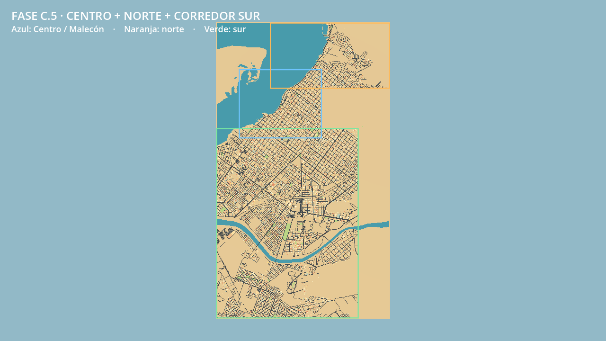
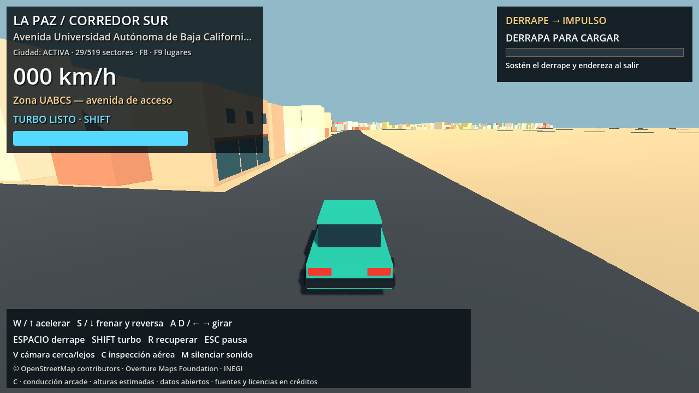
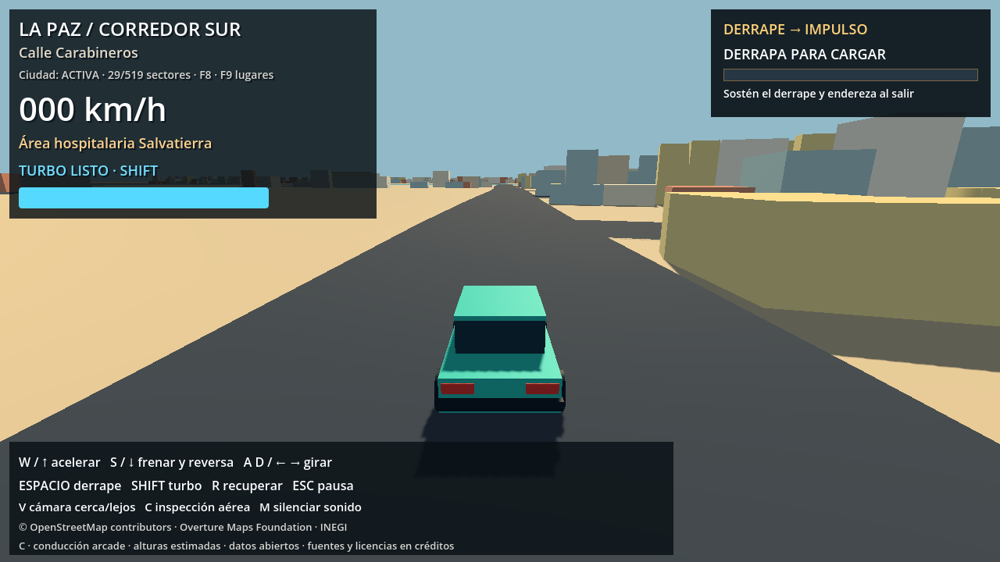

> Estado histórico anterior al recorte de la línea roja. El límite vigente y sus pruebas están en [PHASE_C5_SOUTH_CUT.md](PHASE_C5_SOUTH_CUT.md). Las cifras de esta entrega original no describen el mapa recortado actual.

# Fase C.5 — etapa 3: corredor sur

Se conserva el núcleo Centro/Malecón y el bloque norte. Se agrega el corredor continuo hacia el área hospitalaria Salvatierra, UABCS y conexiones al sur. La selección sur es `[24.09, -110.342, 24.151, -110.292]` (sur, oeste, norte, este); es una envolvente de construcción, no un límite administrativo ni el contorno final de la ciudad.

## Mismo método del núcleo

- Calles basadas en nodos, geometrías y sentidos de circulación OSM. No se crean conectores para tapar discontinuidades.
- Edificios derivados de huellas OSM y Overture Buildings, release fijado 2026-10-21.0; alturas estimadas cuando la fuente no ofrece altura observada. No se incorporan modelos arquitectónicos detallados del hospital o de UABCS.
- Manzanas INEGI y archivo estatal DENUE originales reutilizados con nuevos manifiestos de selección. Relleno ficticio conservador, identificado por registro y excluido de áreas protegidas, campus y hospital.
- Origen y aparición preservados; asfalto arcade mínimo 12 m y factor 1,6; fachadas adaptadas al mismo ancho.
- Sectores alineados a 256 m, streaming de calles y edificios, colisiones próximas y soporte conservado para recuperación.
- Costa y suelo visual continuos. Fuentes offline conservadas con hashes; el juego no descarga datos.

Se conservan las ocho teselas del norte y se agregan veinte teselas sur de la API oficial OSM. Los nuevos agregados usan el sufijo `c5_south`, sin sobrescribir snapshots originales del núcleo/norte. La selección Overture nueva contiene 84.824 huellas antes de recortar a los bloques y aplicar filtros. Overture Places mantiene explícitamente su cobertura parcial del núcleo; OSM y DENUE cubren los nuevos POI.

Las referencias OSM del campus y hospital son `way/137201460` y `way/301737276`. Los puntos de conducción se ajustan a nodos alcanzables de la red vial, no al interior de los edificios. Los nombres son referencias geográficas; no se afirman límites de barrios medidos.

## Escalado del procesamiento

El recorte de huellas usa una partición espacial exacta de la máscara vial en celdas. Cada huella consulta las piezas que intersectan su envolvente; las áreas protegidas y los límites utilizan geometría preparada. Se mantienen los anchos, las reglas de exclusión y la prioridad OSM antes de Overture. La validación comprueba el resultado contra la máscara vial completa.

Durante la partida se liberan las aristas del grafo, etiquetas de auditoría OSM y el duplicado urbano del entorno antiguo, después de comprobar sus hashes. Los archivos offline completos siguen disponibles para reconstrucción, validación y preparación de rutas.

La búsqueda periódica de posición segura del coche consulta un índice local de segmentos, con margen de 32 m alrededor de sus envolventes. El soporte físico y la ausencia de obstáculos siguen comprobándose antes de aceptar una posición de recuperación.

## Resultado de construcción

| Dato | Centro + norte anterior | Centro + norte + sur |
|---|---:|---:|
| Envolventes de bloques, incluidas zonas marítimas | 15,93 km² | 49,36 km² |
| Tramos viales OSM | 2.836 | 14.581 |
| Sectores de asfalto arcade | 138 | 611 |
| Sectores urbanos | 137 | 593 |
| Volúmenes urbanos antes de ajuste arcade | 12.212 | 68.524 |

El conjunto contiene 6.059 volúmenes OSM, 61.465 Overture y 1.000 de relleno ficticio declarado. Todas las alturas siguen estimadas. El ajuste arcade modifica 11.560 huellas y omite 74; quedan 68.450 volúmenes habilitados. Los cambios de fachadas se guardan por sector con hash propio y se leen al cargar ese sector, evitando mantener las 11.634 modificaciones en memoria global. Un sector con hash incorrecto se rechaza y se registra como fallido.

Se preparan dos rutas nuevas sobre aristas dirigidas reales: `tracks/c5_south_hospital.json` (6.505,8 m) y `tracks/c5_south_uabcs.json` (9.772,8 m). Las dos rutas del norte conservan sus hashes. Son alcanzables desde el núcleo 10.729 de los 11.898 nodos del conjunto; no se inventan conexiones para las componentes restantes.

## Rendimiento estático

Comparación con la entrega Centro + norte, mismo inicio y cámara 1280×720, GL Compatibility, RTX 4060 Ti, VSync desactivado, 2 s de calentamiento y 5 s de muestra:

- Tiempo medio por cuadro: 0,764 → 0,745 ms. La diferencia pequeña está sujeta a variabilidad del equipo; no se observa regresión media en esta muestra.
- Memoria estática: 126,3 → 194,4 MiB (+53,9 %), dentro de la relación máxima de 1,60. Esta medida no representa VRAM ni RAM total del sistema.
- Construcción inicial de la escena: 347 → 1.419 ms. La ampliación aumenta el coste de lectura inicial; no equivale al tiempo de apertura del editor.
- Los presupuestos de aceptación del perfil se mantienen sin cambios.

La primera comprobación de conducción detectó un pico de aproximadamente 314 MiB al retener todos los ajustes de fachadas. Tras particionarlos por sector, el mismo recorrido sin render quedó en 220,3 MiB. El informe anterior se conserva como evidencia de diagnóstico, no como resultado final.

## Regeneración

```powershell
.\.venv-urban\Scripts\python.exe tools/expand_map.py
# Solo para fuentes faltantes de una ampliación:
.\.venv-urban\Scripts\python.exe tools/expand_map.py --fetch
.\.venv-urban\Scripts\python.exe -B -m unittest discover -s tests -v
```

Validación en Godot, preservando el benchmark histórico del norte:

```powershell
$g = '..\..\Godot_v4.7.2-stable_win64_console.exe'
$env:APPDATA = Join-Path (Get-Location) '.godot/c5_south_validation_userdata'
$env:LOCALAPPDATA = Join-Path (Get-Location) '.godot/c5_south_validation_userdata/local'
& $g --headless --path . --fixed-fps 60 --script tests/godot_phase_c5.gd
& $g --path . --fixed-fps 60 --script tests/godot_phase_c5.gd
& $g --path . --script tests/benchmark_phase_c5_south.gd
& $g --path . --fixed-fps 60 --script tests/capture_phase_c5.gd
```

El perfil `config/expansion_config.json` declara los tres bloques activos y la selección de fuentes. El HUD identifica CORREDOR SUR. Las rutas son candidatos para futuras carreras ficticias, sin rivales ni carreras nuevas en el menú.

## Límites

El relieve sigue plano y la arquitectura sigue procedural. Campus, instalaciones sanitarias, parques y espacios abiertos conservan el tratamiento de exclusión del núcleo; no se rellenan con edificios inventados para aumentar densidad. El resto del perímetro rojo sigue pendiente.


## Pruebas de datos

38 pruebas Python aprobadas: 12 de mapa, 25 de entorno, expansión, POI, clasificación y ciudad, más la nueva prueba de integridad y pertenencia de las fachadas por sector. La validación geográfica completa confirma 146 superficies, continuidad del suelo, cero solapamiento entre superficies y cero edificios sobre el agua. Incluye 13.133 POI y ocho referencias verificadas por fuente, entre ellas UABCS y Salvatierra.

Informes: `phase_c5_south_geography_validation.json`, `phase_c5_south_driving.json`, `phase_c5_south_driving_render.json`, `phase_c5_south_benchmark.json`. El informe `phase_c5_south_driving_before_facade_streaming.json` documenta el diagnóstico de memoria anterior.

En arranques con perfiles de prueba reutilizados apareció el aviso interno `ShaderGLES3::initialize` ya observado en la etapa norte. Las pruebas terminaron correctamente; se empleó un perfil temporal nuevo para las capturas finales. No se modificó el ejecutable ni el perfil del usuario.


## Conducción y revisión visual

El coche de producción recorrió 23,94 km y 266 intersecciones entre cuatro rutas, sin salidas del asfalto, pérdidas de apoyo, contactos de pared ni recuperaciones durante la conducción. Se repitió con render y sin él. Se comprobaron fachadas y retracción SpringArm en siete referencias y el reinicio desde el sur después de descargar los sectores del núcleo.

| Ruta con render | Distancia prevista | p95 por cuadro | Máximo observado | Pico de memoria estática |
|---|---:|---:|---:|---:|
| Costa norte | 3,699 km | 1,486 ms | 22,577 ms | 196,1 MiB |
| Barrios norte | 3,972 km | 1,503 ms | 56,374 ms | 197,8 MiB |
| Área hospitalaria | 6,506 km | 1,714 ms | 63,628 ms | 206,0 MiB |
| UABCS y conexión sur | 9,773 km | 1,717 ms | 69,994 ms | 206,5 MiB |

Hay picos aislados durante construcción de sectores; estas medidas no prometen ausencia de tirones en todo equipo. El máximo urbano fue 43 de 593 sectores, y el vial 105 de 611. Pasan los presupuestos originales: p95 ≤33,3 ms, memoria estática de recorrido ≤256 MiB, ≤80 sectores urbanos, relación media del benchmark ≤1,25 y relación de memoria ≤1,60.

También pasan fase C, recompensas de derrape y seis casos de salida/reingreso al asfalto. El resumen reproducible de esta validación está en `phase_c5_south_validation.json`. Capturas de acceso UABCS, hospital, conexión sur y vista general revisadas; la vista general carga todos los sectores solo para inspección.




