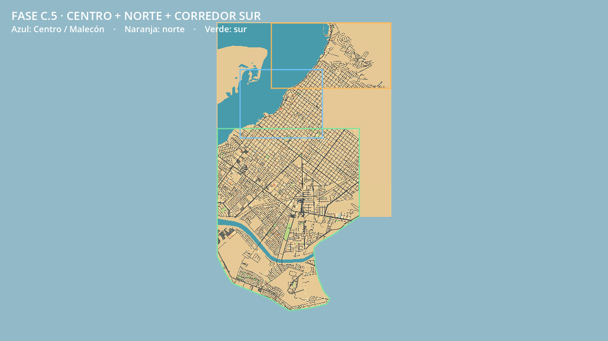

# Corrección del límite sur

La línea roja suministrada por el usuario sustituye la base rectangular del corredor sur. Se conserva el lado norte del trazo, incluyendo el área hospitalaria Salvatierra y el acceso UABCS; toda la franja inferior queda fuera del mapa jugable y visible.

El trazo se digitaliza a partir de la imagen de referencia y su encaje con la envolvente conocida del bloque sur. No representa un límite administrativo ni una medición topográfica. Sus puntos y procedencia quedan explícitos en `config/expansion_config.json`, bajo `south_cut_reference` y `clip_polygon_lonlat`.

## Aplicación del recorte

- Se recortan líneas centrales y superficies completas de asfalto, incluido su ancho arcade. Las puntas de las calles no invaden el área excluida.
- Se omiten edificios y POI fuera del límite. Los sectores de calles y edificios se regeneran y solo los manifiestos nuevos se cargan durante la partida.
- Tierra, costa, agua y áreas abiertas se recortan con la misma máscara.
- La plataforma de seguridad rectangular se sustituye por una superficie física y visual triangulada con el contorno corregido. No queda suelo oculto bajo la línea.
- Se añaden límites físicos invisibles en el borde para impedir que el coche entre o caiga en la zona excluida.
- Las etiquetas de bloque y la vista general usan el polígono real, no su rectángulo envolvente.

Las fuentes originales descargadas permanecen como caché offline y no se vuelven a descargar. Contener coordenadas de la antigua envolvente en un snapshot no las habilita ni las carga en el juego.

## Resultado de generación

| Dato | Antes | Corregido |
|---|---:|---:|
| Área de los bloques, incluidas zonas marítimas | 49,36 km² | 41,98 km² |
| Tramos viales | 14.581 | 12.731 |
| Sectores de asfalto arcade | 611 | 535 |
| Sectores urbanos | 593 | 519 |
| Volúmenes urbanos antes del ajuste arcade | 68.524 | 59.637 |

Se mantienen 58.637 volúmenes de huellas reales y 1.000 de relleno declarado. La adaptación arcade ajusta 9.993 huellas y omite 55. Las alturas y el relieve conservan el tratamiento de la fase anterior.

Centro, el norte y la ruta al hospital conservan los hashes de sus candidatos de recorrido. La referencia de conexión sur se desplaza hacia dentro del nuevo límite y su ruta UABCS se recalcula sobre calles reales: 9,641 km. La ruta al hospital continúa midiendo 6,506 km.

## Validación

La regeneración offline completa `tools/expand_map.py` terminó con las validaciones de mapa, ciudad y geografía aprobadas. La prueba de recorte comprueba todos los triángulos viales, superficies geográficas, plataforma de seguridad y huellas urbanas contra el nuevo polígono.

La prueba física específica confirma ausencia de suelo/asfalto en tres puntos excluidos, apoyo conservado en hospital, UABCS y conexión sur, y detención del coche al intentar cruzar el borde recortado. Informe: `phase_c5_south_cut_physics.json`.

```powershell
.\.venv-urban\Scripts\python.exe tools/expand_map.py
.\.venv-urban\Scripts\python.exe -B -m unittest discover -s tests -v
$g = '..\..\Godot_v4.7.2-stable_win64_console.exe'
& $g --headless --path . --fixed-fps 60 --script tests/godot_south_cut.gd
& $g --headless --path . --fixed-fps 60 --script tests/godot_phase_c5.gd
& $g --path . --script tests/benchmark_phase_c5_south.gd
```




39 pruebas Python aprobadas. Los cuatro recorridos del coche de producción suman 23,81 km y 263 intersecciones, con cero salidas del asfalto, pérdidas de apoyo, contactos de pared o recuperaciones durante la conducción. Se comprueban también cámara/fachadas en siete referencias y reinicio desde el sur.

El benchmark estático con render, en el mismo punto inicial, cámara 1280×720 y RTX 4060 Ti, registra 0,783 ms medios por cuadro y 179,5 MiB de memoria estática, con inicio de escena en 1,30 s. Pasa los presupuestos conservados. Estas medidas no equivalen a RAM total, VRAM ni garantía de FPS en otro equipo.

Resumen y hashes vigentes: `phase_c5_south_cut_validation.json`. Recorridos: `phase_c5_south_cut_driving.json`. Benchmark: `phase_c5_south_cut_benchmark.json`. La vista general fue generada con Godot y revisada visualmente.

También pasan seis pruebas de salida y reingreso al asfalto, comprobando que la plataforma poligonal conserva altura física cero y suelo visible.
