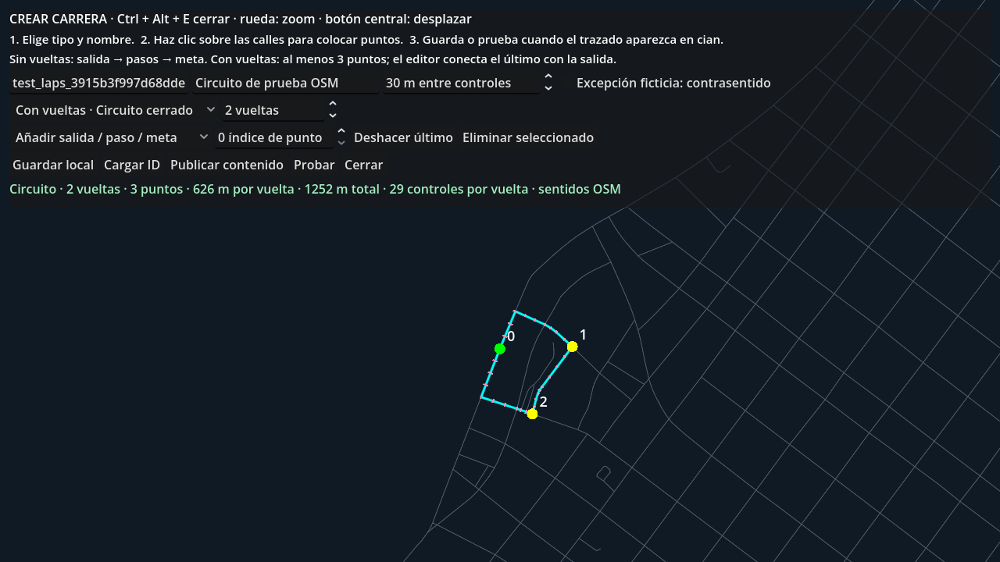
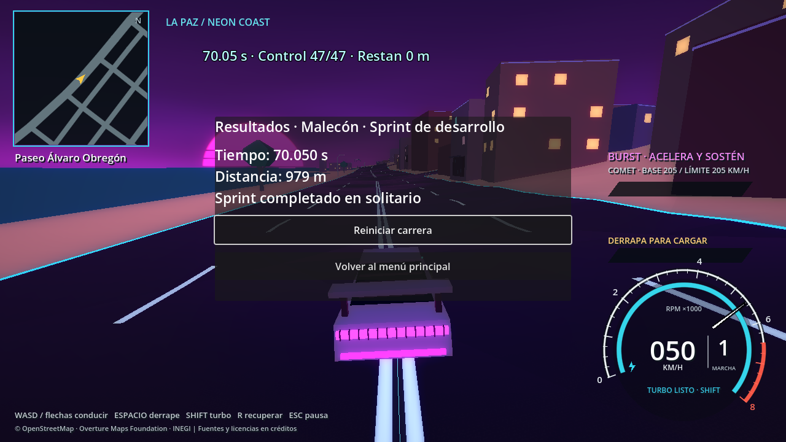

# Fase D.2 — Sprints, editor y carga

Actualización de presentación/navegación: arcos azul/blanco +30 %, recuperación de 3 segundos, minimapa de carrera, cilindro rosa y mapa de pausa para destinos libres. [Uso y validación actuales](RACE_NAVIGATION_UPDATE.md).

Actualización: el editor ya permite **sin vueltas (sprint)** y **circuitos de 1–99 vueltas**, con errores de borrador específicos. Consulta la [guía actual de creación de carreras](RACE_EDITOR_GUIDE.md).

## Uso

**F5 → Jugar → Modo carrera → vehículo → carga → sprint.** El sprint predeterminado es `malecon_sprint_01`, «Malecón · Sprint de desarrollo», unos **978.84 m**, con **47 controles**. Es un recorrido ficticio de competición sobre la geometría OSM existente de Paseo Álvaro Obregón. No se añaden calles ni se alteran parámetros de los coches.

En **modo libre**, el anillo rosa identifica su salida, próxima al spawn del Malecón. A menos de 24 m y por debajo de 3 m/s, **E / mando B** abre la confirmación con nombre y distancia. Cancelar conserva la exploración. Confirmar conserva el vehículo y utiliza el mismo sistema de carrera del menú.

Durante la carrera, sigue la cinta naranja y cruza la siguiente puerta en el sentido del recorrido. La cuenta regresiva bloquea el acelerador; el cronómetro comienza cuando termina. El HUD muestra tiempo, controles y distancia restante. **Esc / Start** permite continuar, reiniciar o abandonar. Resultados permite reiniciar o volver al destino correspondiente al origen. Desde el menú se vuelve al menú; desde exploración se vuelve cerca de la salida con el mismo coche. La pausa recibe foco para teclado/mando. B / Esc cancela la confirmación y permite salir de resultados.

## Editor de desarrollo

Corrección del atajo: F8 está reservado por Godot para detener la ejecución. Se sustituyó por **Ctrl + Alt + E**. La prueba `tests/godot_race_editor_shortcut.gd` pasó siete comprobaciones con entrada nativa, tanto headless como con ventana, incluyendo cerrar con un campo de texto enfocado. No escribe ni regenera carreras. La interfaz y la guía actual muestran el atajo corregido.

1. Inicia modo libre con el ejecutable de desarrollo/editor de Godot y pulsa **Ctrl + Alt + E**.
2. Elige Sin vueltas o Con vueltas; en circuito configura la cantidad. Introduce un nombre y conserva el ID automático, o escribe uno en minúsculas/números/guion bajo.
3. Haz clic sobre la red vial del plano. En sprint, el primer nodo es la salida, los intermedios son pasos obligatorios y el último es la meta. En circuito, coloca al menos tres puntos distintos; el cierre hacia la salida se calcula por la red vial. El clic se ajusta al nodo vial más próximo hasta 80 m; utiliza zoom para elegir intersecciones próximas.
4. La ruta cian se calcula entre esos puntos mediante conexiones dirigidas OSM. Los trazos rosados son los controles. La salida es verde, los pasos amarillos y la meta roja.
5. Rueda para acercar/alejar; botón central y arrastre para desplazar el plano. El mapa del editor funciona con toda la red lógica, independientemente de los sectores 3D cargados.
6. Selecciona «Mover» o «Eliminar», indica el índice visible del punto y haz clic en el mapa. «Deshacer» elimina el último punto. Ajusta la separación de controles entre **10 y 80 m**; también se generan controles en cada extremo de tramo, conservando los pasos e intersecciones de la ruta.
7. Los sentidos OSM se respetan por defecto. La casilla de **excepción ficticia de contrasentido** habilita conexiones inversas y las registra explícitamente en el archivo. Si no existe conexión válida, el editor informa del problema y no guarda una carrera incompleta.
8. «Guardar local» escribe `user://races/<id>.json`; «Cargar ID» reabre un recorrido. «Probar» guarda y lanza el recorrido con tu coche, reutilizando el mundo.
9. «Publicar contenido» escribe `data/races/<id>.json` dentro del proyecto. Configura `default_race_id` en `config/game_flow.json` para convertirlo en el sprint disponible desde menú y con marcador en modo libre.

Ctrl + Alt + E y la propia inicialización del editor requieren **`OS.has_feature("editor")` y `OS.is_debug_build()`**. Los ejecutables exportados no exponen esta herramienta. No se ha añadido un editor público de carreras personalizadas.

El sprint incluido se generó mediante estos mismos métodos del editor durante la prueba integral: nodo próximo al spawn verificado del Malecón, paso obligatorio `313406276` y meta `6195830555`. El archivo conserva los nodos y tramos realmente utilizados; no se dibujó una línea arbitraria entre coordenadas inventadas.



## Inspección y decisiones de arquitectura

El mapa offline ya contiene **11 251 nodos y 23 546 aristas dirigidas**, con referencias OSM de los tramos. `World.gd` descartaba las aristas y etiquetas tras cargarlas porque la conducción sólo necesitaba geometría y sectores. Se conserva ahora una representación de navegación separada antes de esa reducción, sin retener una segunda escena urbana.

| Componente | Responsabilidad |
| --- | --- |
| `RoadGraph.gd` | Índices por ID, conexiones dirigidas, AStar2D legal y grafo de excepciones. Coste geométrico en metros; no depende de mallas cargadas. |
| `RaceStore.gd` | Creación, formato JSON, escritura temporal y renombrado, carga local/contenido y validación. |
| `RaceEditor.gd` | Presentación del plano, puntos obligatorios, edición, generación y publicación. |
| `RaceSession.gd` | Cuenta regresiva, tiempo de simulación, secuencia de puertas, progreso y resultado. Sin nodos ni dependencia de menús. |
| `RaceVisuals.gd` | Línea sobre el relieve y puerta siguiente, sin colisiones propias. |
| `RaceActivity.gd` | Une sesión, coche existente, interfaz, marcador y editor en un único componente del mundo. |
| `GameFlow.gd` | El Autoload de D.1 conserva navegación, vehículo, origen y destino; también coordina la preparación. No se añade otro gestor global. |
| `WorldPreparation.gd` / `LoadingOverlay.gd` | Datos y validación en un hilo aislado; presentación de carga persistente y creación de nodos por etapas en el hilo principal. |

Ambos modos usan **la misma escena `Main.tscn`, el mismo automóvil y la misma sesión de carrera**. El campo provisional `race_scene` de D.1 se elimina: ya no hace falta elegir una escena diferente por modo o recorrido. El origen y destino siguen disponibles en `activity_context()`.

Al completar, resultados se superpone al mundo. Reiniciar sustituye la sesión y las indicaciones, sin duplicar coche ni escena. Volver a exploración elimina sesión/ruta, restaura la reserva de turbo previa y coloca el coche detenido cerca de la salida. Abandonar desde el menú descarga el mundo. Las referencias al mundo siguen siendo débiles; las transiciones rechazan solicitudes duplicadas.

## Formato y validación del contenido

Cada JSON incluye `schema_version`, `id`, `name`, `type`, `map_sha256`, `anchors`, `edges`, `points_xz`, `start`, `finish`, `checkpoints`, `spawn_positions`, `distance_m` y `settings`. Los tramos mantienen `road_id`, `from`, `to` y `wrong_way`. Los tipos implementados son `sprint` y `circuit`. `laps` vale 0 para sprint y de 1 a 99 para circuito. Este último incluye `lap_distance_m`; la geometría y los controles describen una vuelta y `distance_m` incluye todas las vueltas. Los sprints anteriores sin `laps` siguen siendo compatibles.

La ruta se reconstruye desde sus puntos y conexiones. Se comprueban existencia de nodos/tramos, continuidad, dirección, versión del mapa, formato, configuración numérica y concordancia de la geometría derivada. La comparación numérica admite hasta 0.00001 m para el redondeo JSON. No se acepta una puerta cambiada manualmente fuera de la carretera. Los IDs impiden usar rutas de archivos arbitrarias.

Si cambia la huella del mapa, se rechaza la carrera para jugar. El editor permite reabrir los IDs de sus puntos, regenerar sobre las conexiones actuales y volver a guardar después de revisar la nueva ruta. Un nodo desaparecido o desconectado requiere corregir los puntos; no se sustituye silenciosamente por una conexión ficticia.

Los sentidos proceden de las aristas dirigidas del dataset actual, incluidas sus direcciones inversas válidas. **Ese dataset no incluye un modelo completo de restricciones OSM de giro mediante relaciones**; esta fase no afirma respetar restricciones que no estén representadas. Tampoco certifica la precisión de cada etiqueta OSM. El mapa y el editor son para una actividad ficticia dentro del juego.

Los archivos publicados se leen desde `res://data/races/`, con preferencia por un archivo local del mismo ID durante desarrollo. Para distribuirlos, incluir los JSON en los filtros de exportación junto con los demás datos offline del proyecto. No necesitan una escena por carrera, conexión a Internet ni acceso al editor. No se generó todavía un instalador o ejecutable de distribución; se validó con el ejecutable de Godot del proyecto.

## Cruces y progreso

La sesión evalúa el movimiento barrido entre dos posiciones de física, evitando perder controles a velocidad alta. Cada puerta requiere pasar del semiplano anterior al posterior dentro del ancho de la vía. Se rechazan direcciones inversas, cruces laterales, diferencias verticales incompatibles y saltos de posición superiores a `150 m/s × delta + 2 m`. Sólo puede activarse el siguiente control. Un paso directo por la meta no elimina los anteriores.

El ancho se deriva del ancho vial de origen y no se expande para permitir atajos fuera de la vía. Los extremos de tramo tienen controles incluso si están próximos entre sí; los segmentos largos se subdividen por la separación configurada. El progreso se interpola hacia la puerta siguiente dentro de su corredor, sin adelantar controles. Recuperar el automóvil no acredita controles pendientes.

La altura de las indicaciones se obtiene del servicio de superficie existente. La puerta siguiente usa postes finos y una línea baja; no bloquea físicamente ni tapa la carretera. No se altera la aceleración, dirección, turbo, derrape, impulso de derrape ni BURST para facilitar el recorrido.

## Carga funcional y bloqueos corregidos

Antes, `change_scene_to_file()` ejecutaba el `_ready()` del mundo de forma síncrona: lectura y análisis de JSON grandes, hashes y construcción de varios vecindarios. Mostrar primero el texto «Cargando» no mantenía su animación durante ese trabajo.

Ahora un hilo aislado realiza la lectura de datos grandes, hashes y construcción de la red lógica. El árbol activo, los nodos, las colisiones y los materiales se crean en el hilo principal. La separación respeta las [restricciones de hilos documentadas por Godot](https://docs.godotengine.org/en/stable/tutorials/performance/thread_safe_apis.html).

El mundo consume los datos preparados y cede frames entre etapas y sectores iniciales. La selección de carreteras del relieve pasa de búsquedas repetidas en una lista a un conjunto de IDs. Los sectores de ciudad y carretera se siguen cargando incrementalmente después de la salida.

La prueba de cargas repetidas detectó errores RID del renderer dummy relacionados con la precarga existente de mallas con materiales en hilos. Esa precarga se retiró; las pequeñas mallas visuales se cargan con su sector en el hilo principal. La preparación geográfica pesada continúa en segundo plano. La regresión final ya no presenta esos errores.

La pantalla persiste al reemplazar escenas, muestra actividad animada y mensajes de las etapas reales. **No muestra porcentajes**, porque no existe una medida fiable del trabajo total. Su animación usa tiempo para indicar actividad, no para fingir progreso.

Se entrega el control después de preparar el vecindario inicial de carreteras/terreno, colisiones urbanas próximas, coche, aparición apoyada y actividad. Para una carrera también deben validarse la ruta y sus puertas. Se espera la sincronización de física y se comprueba apoyo vial; no basta con que exista la escena. Si falla, se informa y se vuelve al menú.

Desde modo libre se reutilizan mundo y coche. Si la salida ya tiene sus sectores residentes, el reinicio es inmediato y no muestra una carga innecesaria. Si faltan sectores, se bloquea el control y se prepara esa zona por etapas. Durante un traslado se mantienen los gestores detenidos hasta recolocar el coche para que no descarguen la zona nueva siguiendo la posición antigua.

La carga sigue teniendo **picos breves de construcción/creación de recursos**. En la validación renderizada se midieron centenares de frames del indicador durante la carga, con pausas máximas de unas décimas de segundo, registradas exactamente en los informes. No se garantiza ausencia de microparadas en otros equipos o con cachés frías. No se ha dividido internamente cada operación de construcción de un solo sector ni se ha modificado la estrategia global del terreno.


## Pruebas

Motor Godot **4.7.2.stable.official.ed1daf0bf**, Jolt; validación headless y con renderizado OpenGL/NVIDIA RTX 4060 Ti.

- `tests/godot_phase_d2.gd`: **57 comprobaciones**, sin fallos. Comprueba editor, publicación/carga, ajustes de controles, geometría alterada, versión de mapa, sentidos, cruces inválidos, cuenta regresiva, movimiento físico inicial, resultados, menú, interacción real con E, confirmación/cancelación, reinicio, retorno y tres ciclos adicionales de abandono mediante pausa. Revisa un único coche, limpieza y foco de interfaz. Informes `phase_d2_validation.json` y `phase_d2_validation_render.json`.
- `tests/godot_d2_drive.gd`: recorre físicamente el sprint completo con COMET y el controlador existente. Resultado: **47/47 controles, 70.05 s, unos 976.50 m recorridos, 0 recuperaciones**, pico aproximado de 15.76 m/s. Es un conductor exclusivo del ensayo, sin teletransportes; no añade IA al juego. Informe `phase_d2_physical_drive.json` y captura `d2_physical_results.png`.
- Regresión de D.1: **207 comprobaciones** de menús, opciones, mando/teclado, estadísticas y conducción de VECTOR/COMET/APEX. Los contratos provisionales de carrera de D.1 se trasladan al ensayo de D.2; se mantiene el caso de contenido inexistente. Informe `phase_d1_validation.json`, log `d1_d2_regression.log`.
- Regresiones `godot_powertrain.gd` y `godot_burst.gd`: aprobadas sin fallos para los tres perfiles.
- Los diez SHA-256 de referencia de D.1 siguen coincidiendo: controlador, perfiles, balances, mapa, entorno y escena 3D. Informe `phase_d2_baseline_validation.json`.
- Compilación/importación del editor y comprobación de espacios del diff. Las capturas se inspeccionaron para corregir etiquetas cortadas y superposición del HUD.

El ensayo integral usa cruces sintéticos para comprobar los casos límite y flujos rápidamente; su captura de resultados se llama **`d2_results_fixture.png`** y no representa una vuelta conducida. La evidencia de conducción completa es **`d2_physical_results.png`**. Las preferencias de estas pruebas se guardan temporalmente dentro de `tests/` y se eliminan al finalizar; los archivos locales y publicados con ID aleatorio del ensayo se eliminan al terminar, conservando las carreras existentes.

### Reproducir

Desde la raíz, sustituyendo `Godot` por el ejecutable instalado:

```powershell
Godot --headless --path . --editor --quit
Godot --headless --path . --fixed-fps 60 --script tests/godot_phase_d2.gd
Godot --path . --fixed-fps 60 --script tests/godot_phase_d2.gd -- --capture-d2
Godot --headless --path . --fixed-fps 60 --script tests/godot_d2_drive.gd
Godot --path . --fixed-fps 60 --script tests/godot_d2_drive.gd -- --capture-d2
Godot --headless --path . --fixed-fps 60 --script tests/godot_phase_d1.gd
Godot --headless --path . --fixed-fps 60 --script tests/godot_powertrain.gd
Godot --headless --path . --fixed-fps 60 --script tests/godot_burst.gd
```

No ejecutar dos ensayos integrales D.2 simultáneamente: comparten los nombres de contenido, preferencias temporales e informes. La prueba integral publica y elimina un recorrido temporal con ID aleatorio; no reemplaza el sprint predeterminado ni los recorridos del usuario.



## Interfaces y límites para D.3

`GameFlow.activity_context()` entrega modo, vehículo, ID de actividad, origen y destino. `race_requested(context)` notifica la solicitud. `RaceStore.load_id()` y `validate()` entregan una definición vial verificada; `points_xz`, `edges` y `checkpoints` pueden alimentar el seguimiento de rivales. `spawn_positions` contiene hoy la salida del jugador; D.3 debe ampliar y validar las posiciones de los rivales sobre las mismas superficies.

`RaceSession.begin()` / `advance()` separan las reglas del vehículo. `completed(result)` entrega tiempo y controles reales; no se inventa puesto contra competidores inexistentes. `GameFlow.restart_race()`, `cancel_activity()` y `return_from_activity()` conservan el origen. Los futuros rivales pueden utilizar las mismas capacidades de conducción sin duplicar el sistema de menús.

No se implementan rivales NPC, clasificación multivehículo, selector de varias carreras ni Pasaporte La Paz. Los circuitos se incorporaron en la actualización del editor y vueltas. El marcador público corresponde a la carrera predeterminada configurable; otros recorridos se prueban en el editor y pueden publicarse/configurarse como contenido. El editor ajusta salida y pasos a nodos viales, no a cualquier centímetro de una carretera; su orientación y controles se derivan del trazado para mantenerlos transitables.
