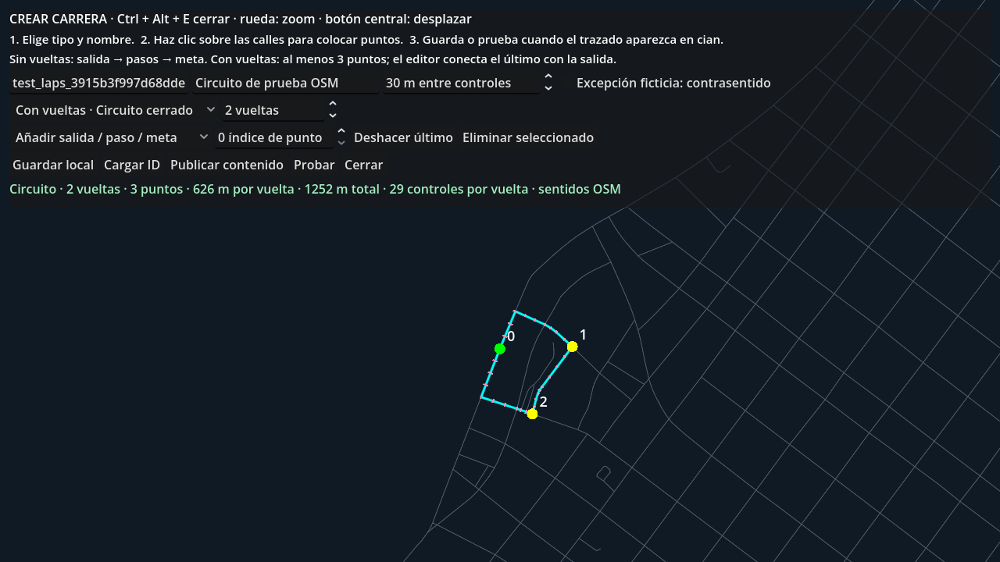

# Crear carreras: sin vueltas o con vueltas

Abre **Modo libre** y pulsa **Ctrl + Alt + E**. La herramienta sólo está disponible durante desarrollo.

## Primera carrera, paso a paso

1. Elige el formato en el desplegable:
   - **Sin vueltas · Sprint A → B**: termina una vez en la meta. El contador de vueltas no se utiliza.
   - **Con vueltas · Circuito cerrado**: repite el recorrido. Elige entre **1 y 99 vueltas** en el control contiguo.
2. Escribe el nombre en el segundo campo. Puedes conservar el **ID automático** del primer campo; si lo cambias, usa minúsculas, números y guion bajo, sin espacios ni acentos.
3. Mantén «Añadir salida / paso / meta» y haz clic sobre las **calles del plano**, por debajo de los controles:
   - En sprint, el primer punto verde es la salida y el último rojo la meta. Cada punto intermedio obliga a pasar por esa zona.
   - En circuito, coloca **al menos tres puntos distintos alrededor del recorrido**. El editor calcula el camino del último punto a la salida por calles conectadas. No hace falta repetir el primer punto al final.
4. Revisa la **línea cian**: ése es el recorrido que se jugará. El editor busca el camino vial más corto entre tus puntos; si pasa por otra calle, añade puntos intermedios para obligarlo a seguir la que quieres. Los trazos rosados son los controles automáticos.
5. Cuando el mensaje inferior esté en **verde**, pulsa **Guardar local** o **Probar**. Probar guarda primero y te coloca en la salida con tu vehículo. Esc durante la carrera permite reiniciar o abandonar.

La rueda cambia el zoom y el botón central permite desplazar el plano. Los clics se ajustan a nodos de la red vial, especialmente intersecciones; acerca el zoom si dos clics terminan en el mismo punto. No se pueden colocar puntos libres fuera de una carretera para unirlos con una línea inventada.



## Corregir el trazado

- **Deshacer último** elimina el último punto añadido.
- Para mover uno, elige «Mover punto seleccionado», introduce su índice (0, 1, 2…) y haz clic sobre la nueva posición vial.
- **Eliminar seleccionado** borra el índice indicado directamente.
- El control «m entre controles» cambia su separación máxima. Las intersecciones y los extremos de tramo también conservan controles obligatorios.
- Los sentidos OSM se respetan por defecto. Si se necesita una excepción para el recorrido ficticio, activa expresamente «contrasentido» y revisa la ruta resultante.

Si Guardar o Probar están desactivados, lee el mensaje inferior. Indica lo que falta: salida/meta, un nombre, un ID válido, puntos repetidos, tres puntos distintos para circuito o una conexión transitable entre puntos. Estos botones ya no intentan guardar un borrador vacío ni sustituyen la explicación por «formato no compatible».

## Guardar, volver a abrir y publicar

**Guardar local** escribe `user://races/<id>.json`. Conserva el ID para escribirlo en el primer campo y pulsar **Cargar ID** después. Se recuperan nombre, puntos, formato y vueltas.

**Publicar contenido** escribe `data/races/<id>.json` en el proyecto. Para que ese recorrido sustituya al predeterminado del menú y del marcador libre, configura su ID en `default_race_id` de `config/game_flow.json`. Probar funciona directamente desde el editor sin cambiar la carrera predeterminada.

## Qué significa una vuelta

El circuito guarda una sola geometría cerrada y su cantidad de vueltas. Tras completar todos los controles y cruzar el cierre en la dirección válida, se suma una vuelta y se reactivan todos los controles en orden. Atravesar repetidamente la meta no permite omitirlos. El HUD muestra la vuelta actual; resultados indica cuántas se completaron. Reiniciar pone a cero vueltas, controles y tiempos.

La distancia total es la distancia aproximada de una vuelta multiplicada por la cantidad configurada. La herramienta muestra ambas. Los sprints anteriores sin el campo `laps` siguen siendo válidos y se interpretan como **sin vueltas**.

## Verificación y decisiones

Se conserva `schema_version=1`: `type` admite `sprint` y `circuit`; los nuevos archivos incluyen `laps` (0 en sprint, 1–99 en circuito). El circuito añade `lap_distance_m`; `distance_m` representa la distancia total y los controles conservan sus distancias dentro de una vuelta. La validación reconstruye el cierre sobre la red OSM, comprueba las distancias y rechaza vueltas fraccionarias, cero vueltas en circuito o geometría alterada. No se modifican el mapa ni la física.

`RaceStore.build()` devuelve tanto datos como la causa concreta del borrador inválido. El editor conserva los puntos al corregir nombre/ID, actualiza el diagnóstico al editar y habilita Guardar/Publicar/Probar cuando el recorrido es válido. La regla de IDs se limita a los caracteres permitidos; se retira la normalización adicional redundante. `RaceSession` cuenta vueltas, progreso total y tiempos por vuelta; `RaceActivity` presenta esa información.

Pruebas ejecutadas:

- **87 comprobaciones** de edición y vueltas, aprobadas headless y con renderizado. Incluyen clics sobre el plano (eventos nativos con ventana; manejador de entrada sin ventana), errores concretos, guardado/carga, compatibilidad del sprint previo, circuito cerrado de dos vueltas, meta anticipada, resultados, reinicio y retorno. Informes `editor_laps_validation*.json`.
- **57 comprobaciones de regresión D.2**, aprobadas. Ahora los recorridos del ensayo usan IDs aleatorios y se eliminan al terminar para conservar el contenido existente del usuario.
- **Conducción física headless de dos vueltas** sobre un circuito OSM de unos 626.10 m por vuelta: 29 controles por vuelta, ambas completadas, 266.00 s y 0 recuperaciones. Informe `laps_physical_drive.json`. El conductor del ensayo frena antes de las esquinas; su primera variante sin anticipación quedó bloqueada en una esquina, por lo que se corrigió únicamente el conductor de pruebas. No se añade IA al juego ni se cambian los parámetros del coche.
- Las capturas `laps_hud.png` y `laps_results_fixture.png` usan cruces sintéticos para revisar la interfaz; sus tiempos no representan una conducción real. La conducción completa se acredita con el informe físico separado.

Comandos, desde la raíz y sustituyendo `Godot` por el ejecutable instalado:

```powershell
Godot --headless --path . --fixed-fps 60 --script tests/godot_editor_laps.gd
Godot --path . --fixed-fps 60 --script tests/godot_editor_laps.gd -- --capture-laps
Godot --headless --path . --fixed-fps 60 --script tests/godot_phase_d2.gd
Godot --headless --path . --fixed-fps 60 --script tests/godot_d2_drive.gd -- --test-circuit
```

El formato permite crear circuitos para probarlos y publicarlos, pero todavía no incorpora rivales, selector de varias carreras ni edición pública en los ejecutables exportados.
