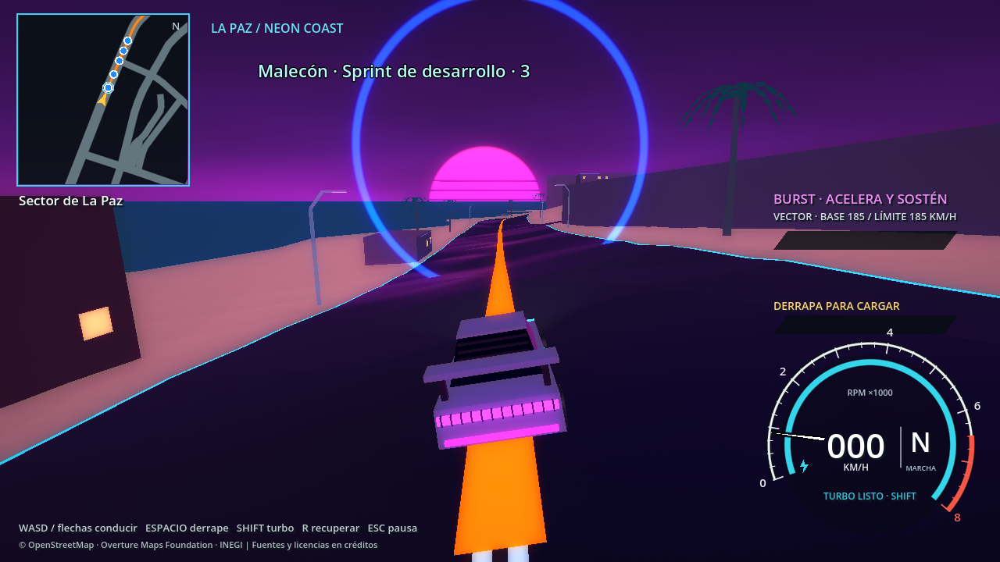
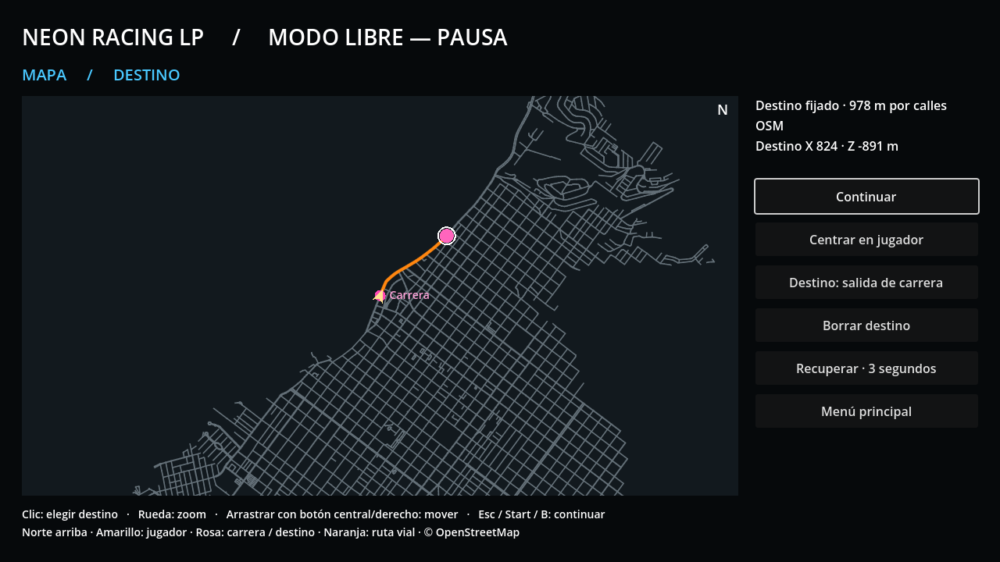
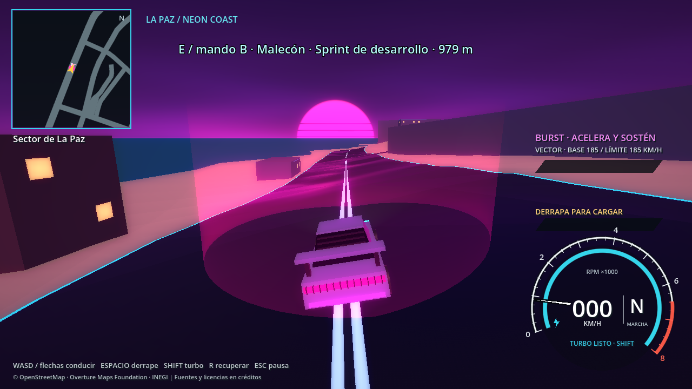

# Checkpoints, recuperación y mapa de destinos

## Cambios disponibles

1. **Checkpoints:** aros circulares azul neón con transparencia degradada en ambos bordes de su banda. El borde inferior queda **un cuarto del radio por debajo del nivel local de la carretera**: el centro está a 0.75 radios sobre ella. Se conserva el factor de escala 1.3 y la zona de cruce anterior; el radio se calcula para mantener el ancho de paso a nivel de la vía. Son indicaciones sin colisión física.
2. **Recuperación:** R / mando Y y el botón correspondiente esperan **3 segundos de juego**, mostrando cuenta regresiva. En carrera devuelven al último checkpoint validado; antes del primero, a la salida. En modo libre utilizan el último punto seguro. El coche se bloquea durante la espera, sin velocidad residual ni turbo activo. El cronómetro de carrera continúa; pausar detiene la cuenta. No se modifican vueltas ni controles pendientes.
3. **Ruta de carrera:** cinta naranja neón de **0.8 m de ancho**, con triángulos sobre la superficie, en lugar de líneas GPU de un píxel. La geometría se subdivide cada 4 m para seguir el relieve.
4. **Minimapa:** ruta naranja y hasta cinco checkpoints cercanos pendientes, dentro de su área visible. El siguiente tiene un contorno adicional. La selección de destino libre usa también una línea naranja y una marca de destino.
5. **Entrada a carrera:** cilindro rosa neón abierto, de 4 m de radio y 5 m de altura. El color se desvanece hacia arriba y permite ver el escenario detrás mediante mezcla aditiva. El minimapa y el mapa de pausa muestran su ubicación. Se conserva la interacción E / mando B y su distancia original.
6. **Pausa en modo libre:** mapa amplio de La Paz, con composición de menú oscura, cabecera y panel lateral, inspirado en la distribución de los mapas de pausa de juegos de mundo abierto. Toda la interfaz se dibuja con controles propios de Godot; no incorpora recursos de GTA.



## Controles del mapa

**Esc / Start** abre la pausa desde modo libre y detiene la simulación. Haz **clic izquierdo sobre una carretera** para elegir destino. La selección se ajusta a un nodo de la red vial habilitada, hasta 100 m del clic; no teletransporta el automóvil.

- Rueda: acercar/alejar alrededor del cursor.
- Arrastrar con botón central o derecho: desplazar el mapa.
- Centrar en jugador: recuperar la vista del coche.
- Destino: salida de carrera: marcar la entrada de la carrera predeterminada.
- Borrar destino: quitar la guía.
- Continuar, Esc, Start o mando B: cerrar el mapa y volver a conducir.

La guía permanece en el minimapa y se recalcula al avanzar/desviarse. Se elimina al llegar a menos de 18 m del destino. Sobrevive a una carrera iniciada desde ese mundo libre; no se guarda entre sesiones. El ratón permite seleccionar cualquier destino; con mando se pueden recorrer los botones del panel y cerrar el mapa, pero no se añade todavía un cursor libre de mapa para el stick.

La pausa durante una carrera conserva el menú compacto: continuar, recuperar último checkpoint, reiniciar y abandonar. No permite elegir un destino libre mientras se compite.





## Arquitectura y decisiones

`RaceGeometry.gd` centraliza el factor 1.3 para presentación, cruce y previsualización del editor. Los archivos de carreras conservan sus anchuras de origen y su formato; no hace falta regenerarlos para aplicar esta presentación. `RaceVisuals.gd` genera un solo aro activo de 96 segmentos y una malla, sin colisiones, y `RouteRibbon.gd` genera una malla naranja por recorrido.

`RaceSession.checkpoint_passed` informa cada control realmente acreditado, incluso si se cruzan varios en un frame. `RaceActivity` guarda la posición y dirección del último, coordina la cuenta de recuperación y conserva el progreso. La espera bloquea la física del vehículo; `ArcadeCar.apply_recovery_pose()` reutiliza el mismo reinicio de transmisión, habilidades, velocidad y efectos que ya tenía el coche. Un `Callable` opcional enruta las solicitudes de recuperación hacia la actividad. Las escenas de pruebas sin actividad mantienen su recuperación anterior.

Después de los tres segundos, se preparan las colisiones necesarias y se verifica la pose antes de devolver el control. Si faltan sectores, esa preparación puede añadir tiempo a la espera; no se suelta el coche sobre geometría inexistente. En el ensayo, el tiempo registrado fue de unos **3.067 s**, incluyendo entrega de entrada y sincronización de física. Se bloquean transiciones incompatibles durante la colocación y se cancela la recuperación al reiniciar/abandonar. Si falla la preparación, se informa mediante el flujo existente y se vuelve al menú.

`FreeDriveNavigation.gd` es un componente del mundo, no un Autoload adicional. Guarda el destino y la ruta. Reutiliza `RoadGraph` y sus aristas dirigidas: comienza en una proyección sobre una carretera próxima al coche y sólo permite salir hacia extremos habilitados por el sentido de circulación. No dibuja una recta a través de manzanas para conectar con una intersección arbitraria. Una selección sin conexión no genera una ruta ficticia.

El mapa OSM contiene 13 976 tramos y el relieve completo actual habilita 13 697. `WorldPreparation.gd` prepara en el hilo de datos un índice AStar específico para GPS con esos IDs activos. La red original del editor/carreras permanece disponible para sus contratos anteriores. Tanto la selección GPS como el dibujo del mapa de pausa excluyen los tramos que el mundo actual no carga como vías transitables. Este índice lógico no depende de que todos sus sectores estén visibles.

`FreeDrivePause.gd` presenta la pantalla completa y delega las acciones a `DrivingHUD`; `PauseRoadMap.gd` presenta y transforma coordenadas del plano. `DrivingMinimap.gd` consume la sesión o la navegación libre y mantiene el norte arriba. La navegación conserva las mismas limitaciones de relaciones de giro del dataset ya documentadas en D.2; no añade reglas cartográficas inventadas.

El shader del cilindro utiliza color aditivo enmascarado por altura, compatible con la vía de renderizado utilizada por los efectos BURST existentes. No escribe profundidad ni proyecta sombras y no incorpora cuerpo físico. Se revisó el brillo en capturas para evitar oscurecer la carretera o tapar el vehículo.

No cambian las ecuaciones de conducción, balances de perfiles, cartografía ni generación urbana. El controlador del coche cambia únicamente para enrutar la recuperación y exponer su reinicio seguro, por lo que su SHA-256 cambia de forma intencional. El resto de las referencias de mapa, entorno, perfiles, configuración y escena 3D coincide con la línea base; informe `navigation_baseline_validation.json`.

## Validaciones realizadas

- **48 comprobaciones headless y 50 con renderizado**, sin fallos: escala, circularidad, profundidad enterrada, degradado y zona del aro, cinta de ancho métrico, cilindro, minimapa, clic real de destino, ruta por vías habilitadas, pausa, botón de destino de carrera, borrado, tecla R, bloqueo de tres segundos, inmovilidad, reloj, pose apoyada, recuperación libre, reinicio y limpieza al volver al menú. Informes `race_navigation_validation*.json`.
- **207 comprobaciones D.1**, **57 de D.2** y **87 del editor/vueltas**, aprobadas. También pasan transmisión y BURST para los tres perfiles.
- Recorrido con el automóvil físico: **47 controles, unos 976.49 m, 70.45 s y 0 recuperaciones**. El conductor es exclusivo de pruebas, no un rival añadido al juego. La recuperación se prueba por separado; no se presenta un salto de posición de una prueba como conducción real.
- Capturas reales de OpenGL con RTX 4060 Ti, revisadas para aro, color, transparencia, mapa, minimapa y cuenta de recuperación. Las pruebas de transmisión usan escenarios mínimos sin navegación; la interfaz mantiene compatibilidad con ellos.
- Compilación/importación con Godot 4.7.2 y revisión del diff. Los ensayos no modifican carreras del usuario; los de D.2/editor utilizan IDs temporales propios.

Comandos desde la raíz, sustituyendo `Godot` por el ejecutable instalado:

```powershell
Godot --headless --path . --fixed-fps 60 --script tests/godot_race_navigation.gd
Godot --path . --fixed-fps 60 --script tests/godot_race_navigation.gd -- --capture-navigation
Godot --headless --path . --fixed-fps 60 --script tests/godot_phase_d1.gd
Godot --headless --path . --fixed-fps 60 --script tests/godot_phase_d2.gd
Godot --headless --path . --fixed-fps 60 --script tests/godot_editor_laps.gd
Godot --headless --path . --fixed-fps 60 --script tests/godot_powertrain.gd
Godot --headless --path . --fixed-fps 60 --script tests/godot_burst.gd
Godot --headless --path . --fixed-fps 60 --script tests/godot_d2_drive.gd
```

No se añaden rivales, actividades turísticas, viaje rápido ni guardado persistente de destinos en esta entrega.


## Actualización de aros circulares

Se sustituye únicamente la presentación del checkpoint: `RaceVisuals.gd` y `checkpoint_ring.gdshader`. El shader usa mezcla aditiva y difumina el borde interior y exterior para que el escenario siga visible. La parte sumergida se oculta mediante la profundidad de las carreteras/terreno existentes; no se recorta ni deforma el mapa.

Para conservar el paso anterior, con anchura media base `h`, escala `s=1.3` y centro `0.75 R`, el radio mundial es `R = h × s / sqrt(1 - 0.75²)`. Por tanto, la cuerda del círculo a nivel de carretera mantiene la anchura de detección existente y su punto más bajo está a `−0.25 R`. En pendientes, la referencia es la altura de la vía en el centro del checkpoint, no la cota global cero.
