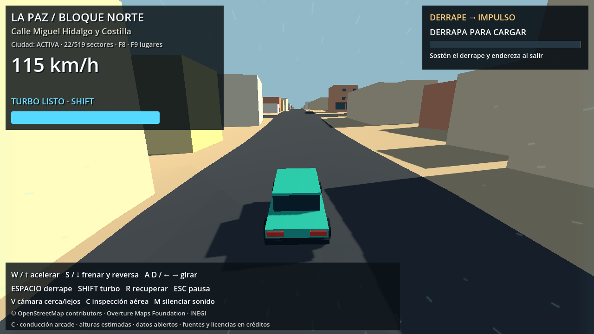
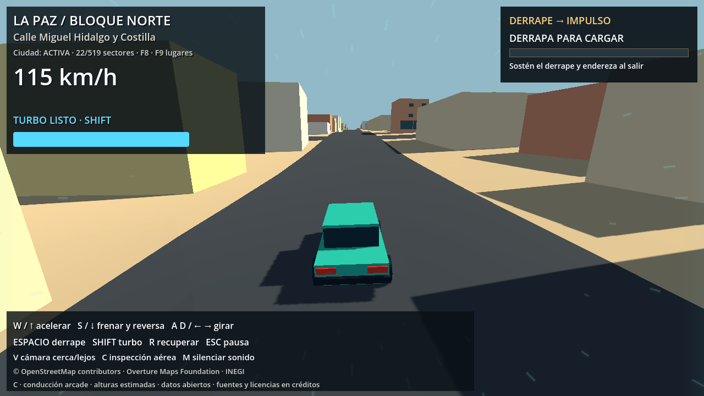

# Conducción con pendientes y pequeños vuelos

Implementación sobre el `CharacterBody3D` de producción. El mapa, sus elevaciones y colisiones no se modificaron. No se añadieron plugins ni un vehículo alternativo.

## Modo de pruebas con T

**T** alterna velocidad máxima y aceleración del motor ×2; otra pulsación restaura los valores normales. Comienza desactivado al abrir una escena y el HUD muestra `PRUEBA ×2` mientras está activo. No modifica el JSON de configuración ni acumula multiplicadores por mantener la tecla presionada. Recuperar el coche conserva el modo elegido.

En asfalto pasa de 32 a 64 m/s y de 13 a 26 m/s²; con turbo, de 44 a 88 m/s y de 19 a 38 m/s². También escala reversa, límite fuera del asfalto y recompensa de derrape. Conserva gravedad, fuerza de frenado y condiciones de despegue. Al desactivarlo a alta velocidad, el limitador existente reduce la velocidad progresivamente. Es una herramienta de pruebas; la transitabilidad del mapa a estas velocidades requiere evaluación manual.

Prueba reproducible: Godot `--headless --fixed-fps 60 --path . --script tests/godot_debug_speed.gd --log-file <ruta_absoluta>`. Resultados: `docs/debug_speed_validation.json`.

## Comportamiento

- La componente de gravedad paralela a la superficie actúa sobre el movimiento longitudinal. Soltar el acelerador en una bajada permite que el coche ruede y gane velocidad; orientado hacia arriba, pierde velocidad y puede retroceder.
- El motor compite con esa gravedad. Una aceleración insuficiente no se convierte en una fuerza extra de frenado automático. Con acelerador completo subir sigue siendo posible en las pendientes actuales, pero la aceleración es menor que en plano.
- **Espacio** mantiene el freno de mano y permite sostener el coche en una pendiente. **S / flecha abajo** conserva el control combinado de freno y reversa: después de detenerse puede iniciar la marcha atrás.
- Al coronar una subida con suficiente velocidad, se conserva el impulso vertical que ya tenía el coche y se desactiva temporalmente la adhesión al suelo. La gravedad produce después la caída y el aterrizaje. Una subida de pendiente constante no dispara un salto por sí sola.
- En el aire se conserva el movimiento horizontal: acelerar o frenar no empuja ni detiene el coche. La dirección tiene solo un 10% de autoridad para orientar el chasis. Las ruedas visuales vuelven a sus anclajes y dejan de extenderse hacia el terreno.

F5 ejecuta el mapa completo con estos cambios. No existe un botón de salto ni un impulso ascendente añadido al pulsar acelerador.

## Implementación y ajustes

`scripts/driving/ArcadeCar.gd` obtiene la normal real de contacto y calcula la gravedad tangencial con `Vector3.DOWN.slide(normal) * gravity`. La respuesta longitudinal evita deslizamiento lateral libre para conservar el manejo arcade.

La detección de cresta comprueba si la trayectoria balística prevista se separaría del apoyo futuro. Ese apoyo se consulta con raycasts contra carreteras y terreno, incluyendo las cuatro esquinas de la caja. No depende exclusivamente del DEM y puede funcionar sobre rampas o estructuras físicas. La consulta se hace solo con velocidad y ascenso suficientes.

Durante la salida de la cresta se retiene brevemente el momento ascendente para que la caja pueda separarse físicamente; limitarlo antes de terminar de abandonar una rampa rápida la volvería a pegar al suelo. Al quedar en el aire se limita la velocidad ascendente a 6 m/s. Frenar antes de abandonar el contacto cancela la salida preparada. La recuperación y los teletransportes limpian ese estado.

Parámetros en `config/driving_config.json`:

| Parámetro | Valor | Efecto |
|---|---:|---|
| `coast_deceleration_mps2` | 0,6 | Resistencia al rodar sin acelerador; antes era 4,0 |
| `gravity_mps2` | 22 | Gravedad arcade ya existente, ahora también proyectada sobre pendientes |
| `acceleration_mps2` | 13 | Aceleración normal del motor, conservada |
| `braking_mps2` | 26 | Freno de servicio, conservado |
| `handbrake_deceleration_mps2` | 15 | Freno de mano, conservado |
| `crest_min_speed_mps` | 14 | Velocidad mínima para preparar el despegue, unos 50 km/h |
| `crest_min_rise_mps` | 1,2 | Ascenso mínimo previo |
| `crest_prediction_s` | 0,14 | Horizonte de comprobación balística |
| `crest_min_clearance_m` | 0,08 | Separación prevista mínima del apoyo |
| `crest_max_vertical_speed_mps` | 6 | Límite ascendente una vez en el aire |
| `crest_cooldown_s` | 0,3 | Evita preparar repetidamente el mismo salto |
| `air_steering_multiplier` | 0,1 | Autoridad de dirección en el aire |

La altura real del vuelo depende de la velocidad y de cómo descienda el terreno después de la cresta; el límite de velocidad ascendente no garantiza una altura máxima sobre cualquier barranco. La gravedad de 22 m/s² es una elección arcade heredada, no la aceleración gravitatoria terrestre. Se mantienen caja de colisión vertical y carrocería visual adaptada al suelo; no se simulan masa, suspensión independiente, vuelcos ni dinámica completa de un automóvil.

## Pruebas

`tests/godot_slope_physics.gd` construye una pendiente sintética del 25% y usa el controlador de producción sin servicio de elevaciones. Resultados:

- Bajada libre desde reposo: 9,93 m en dos segundos y 9,15 m/s al final.
- Freno de mano: desplazamiento medido cero durante tres segundos en pendiente.
- Subida con 15% de acelerador: termina retrocediendo a unos 4,84 m/s.
- Acelerador completo durante un segundo: 7,82 m/s en subida frente a 13,00 m/s en plano.
- Una subida sin motor pierde su impulso y retrocede.
- A 30 m/s en una pendiente constante no despega.
- Cresta lenta a unos 8 m/s: sin vuelo ni despegues.
- Cresta rápida: un despegue, 33 cuadros de vuelo a 60 Hz, unos 82 cm sobre el apoyo, velocidad ascendente limitada y aterrizaje normal. Acelerador y frenos en el aire no cambian de forma apreciable la velocidad horizontal.

`tests/godot_real_crest.gd` comprueba el tramo real `28531909:0`, Calle Miguel Hidalgo y Costilla: vuelo de 18 cuadros, separación máxima aproximada de 23 cm, aterrizaje en asfalto y cero contactos de pared o recuperaciones. Los datos usados para seleccionar esa prueba quedan en `slope_real_crest_candidates.json`.

Se comprobó además que las ruedas visuales no penetren la carretera en el despegue. La captura con render usa el mismo controlador y deja los neumáticos al menos unos 5 mm sobre la superficie durante los cuadros de vuelo de esa prueba.





También se ejecutan las pruebas de controles, frenado, reversa, cámara, recuperación, derrape/bonus, piloto y los cuatro recorridos del mapa. La prueba histórica de límites se adaptó al polígono C.5: su antigua esquina rectangular sur estaba fuera del área jugable. Se conserva la exigencia de detener el coche en cuatro límites físicos reales.

```powershell
$g = '..\..\Godot_v4.7.2-stable_win64_console.exe'
& $g --headless --path . --fixed-fps 60 --script tests/godot_slope_physics.gd
& $g --headless --path . --fixed-fps 60 --script tests/godot_real_crest.gd
& $g --headless --path . --fixed-fps 60 --script tests/godot_drift_rewards.gd -- --slope-regression
& $g --headless --path . --fixed-fps 60 --script tests/godot_phase_b.gd -- --slope-regression
& $g --headless --path . --fixed-fps 60 --script tests/godot_relief.gd -- --relief-pilot
& $g --headless --path . --fixed-fps 60 --script tests/godot_relief_world.gd
& $g --headless --path . --fixed-fps 60 --script tests/godot_phase_c5.gd -- --slope-regression
.\.venv-urban\Scripts\python.exe -B -m unittest discover -s tests -v
```

Los informes nuevos usan el prefijo `slope_`; las regresiones de relieve también actualizan sus informes propios. Las mediciones de tiempo de las ejecuciones headless no son un benchmark gráfico ni una comparación de rendimiento.

Resultado final: 47 pruebas Python aprobadas, controles y derrapes aprobados, piloto aprobado y cuatro recorridos de unos 23,7 km aprobados tanto en el mundo plano como con relieve. En los recorridos urbanos a velocidad de prueba no hubo salidas de asfalto, contactos de pared ni recuperaciones. Los vuelos intencionales de las pruebas de cresta se validan aparte, con aterrizaje y sin penetración visual de neumáticos. Resumen con hashes y referencias: `slope_physics_summary.json`.

La copia exacta del controlador y configuración anteriores está en `docs/slope_physics_baseline/`. `config/relief_migrations.json` enlaza los hashes aprobados con pruebas actuales, conservando los hashes originales de la ciudad y su archivo histórico de conducción. Al cambiar de nuevo estos archivos es necesario repetir y actualizar esa evidencia; no editar los datos originales para evitar las comprobaciones.
